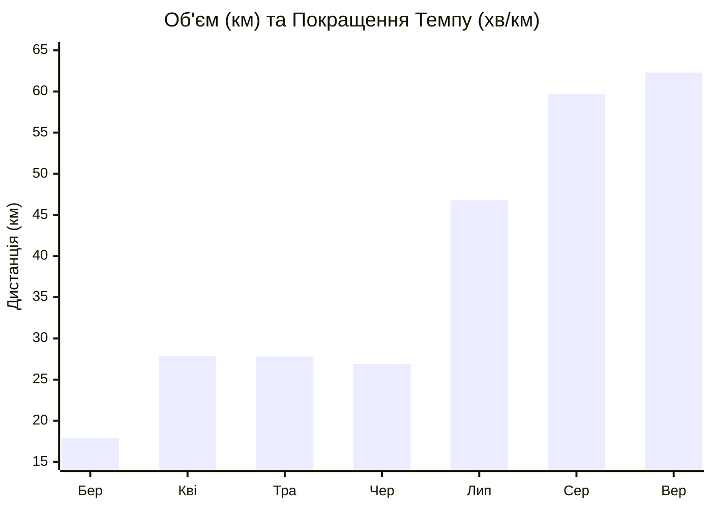
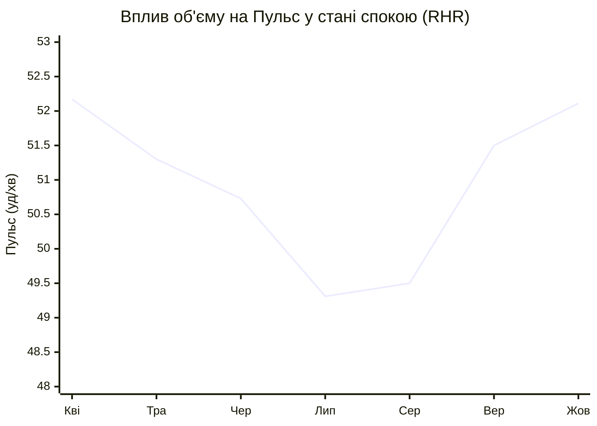

# 🏃‍♂️ Звіт: Аналіз бігу та здоров'я (Strava + Apple Health)

Цей звіт показує твій прогрес за 2026 рік, об'єднуючи дані з твоїх пробіжок (Strava) та метрики здоров'я (Apple Health).

## 📊 Основні тренди

Твій прогрес просто феноменальний! Збільшення бігового об'єму дало дуже сильний позитивний ефект на твою серцево-судинну систему.

### 1. VO2 Max (Максимальне споживання кисню)
- **Лютий 2026:** 37.73
- **Вересень-Жовтень 2026:** ~44.35
> **Твоя кардіо-форма виросла на 17.5%!** VO2 Max — це головний показник аеробної витривалості. Збільшення з 37 до 44 означає, що твоє серце і легені тепер набагато ефективніше постачають кисень до м'язів.

### 2. Варіабельність серцевого ритму (HRV)
- **Лютий 2026:** 86.96 ms
- **Жовтень 2026:** 105.49 ms
> **HRV зріс майже на 20 мс!** Високий HRV означає, що твоя нервова система дуже добре справляється зі стресом і швидко відновлюється. Це прямий результат регулярних тренувань. Тіло стало набагато стійкішим.

### 3. Пульс у стані спокою (Resting HR)
- **Квітень 2026:** 52.17 ударів/хв
- **Липень-Серпень 2026:** ~49.3 - 49.5 ударів/хв
> Твій пульс у стані спокою впав нижче 50 ударів за хвилину під час місяців найбільшого навантаження! Це класична "спортивна брадикардія" — серце стало сильнішим, тому йому потрібно менше ударів, щоб прокачати кров. У вересні він трохи піднявся (51.5), що може бути наслідком накопиченої втоми від рекордних 62 км і вищого темпу.

---

## 📈 Графіки прогресу

### Дистанція та Темп (Strava)

*(Лінія відображає середній темп: чим нижче значення, тим швидше ти біжиш. Зверни увагу, як темп впав з 7:47 до 6:39 при збільшенні об'єму!)*

### Дистанція vs Пульс у стані спокою (Apple Health)

*(Зі збільшенням тренувань навесні та влітку твій пульс у спокою стабільно падав. Легкий підйом восени свідчить про інтенсифікацію тренувань (швидший темп) і необхідність хорошого відновлення).*

---

## 🚀 Як можна покращитись ще більше?

1. **Контроль інтенсивності (Не забувай про Recovery)**
   Твій темп у вересні сильно зріс (6.66 хв/км у середньому), що класно! Але через це трохи піднявся пульс у стані спокою (з 49.5 до 51.5) і впав пульс на самих пробіжках. Це означає, що тіло отримує більше стресу. 
   **Рекомендація:** Переконайся, що 80% твоїх пробіжок залишаються дійсно легкими (пульс до 135). Якщо ти почуваєшся втомленим, не бійся збавити темп до 7:15-7:30 хв/км.

2. **Слідкуй за HRV перед важкими тренуваннями**
   Оскільки твій Apple Watch міряє HRV, використовуй його. Якщо вранці твій HRV суттєво нижчий за середній (наприклад, падає до 70-80), це знак, що сьогодні краще зробити легкий recovery run або взагалі відпочити. Якщо він >100 — це ідеальний день для довгої пробіжки або інтервалів!

3. **Силові тренування для ніг**
   Оскільки об'єми наблизились до 60+ км на місяць, ризик травм колін і зв'язок зростає. 1-2 рази на тиждень виконуй базові вправи: випади, присідання та вправи на ікри (calf raises). Це дасть змогу безпечно збільшувати дистанцію до напівмарафону.

4. **Періодизація об'єму**
   Ти нарощував об'єм кілька місяців поспіль. Тренувальна наука радить робити кожен 4-й тиждень "розвантажувальним" (зменшити кілометраж на 20-30%), щоб дати суглобам відновитись.
