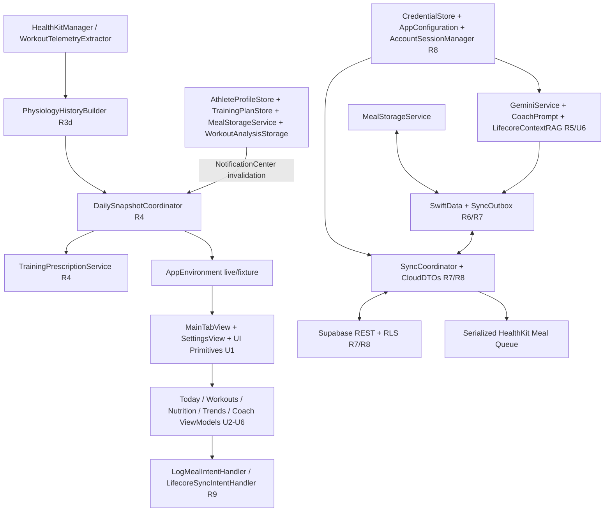

# Lifecore architecture

Updated: 2026-11-13 (Waves 1-6: R1-R9 + U1-U6). Target architecture specification: [redesign specification](superpowers/specs/2026-11-12-native-redesign-design.md).

## Product and platform

Lifecore combines workout telemetry, recovery context and nutrition into athletic decisions. Native iOS remains the primary client and math engine. SwiftUI/Charts present four tabs plus a modal Settings flow; HealthKit reads and exports device data; SwiftData persists local records and durable sync operations; Supabase REST synchronizes meals, workout analyses, and telemetry; Gemini supplies qualitative recognition and narrative.

Actual project settings: iOS 27.0 deployment floor, Swift 5.0 language mode, verified Xcode 27.1 toolchain (`LifecoreTests` hosted suite: 140 passing tests on `iPhone 17` iOS 27.0). Swift 6 language-mode migration remains a separate tracked gate.

## Current component/data flow (R1–R9 + U1–U6)

R4 establishes `DailySnapshotCoordinator` and `TrainingPrescriptionService` as the single evaluated snapshot and prescription source; feature screens (`U2-U6`) consume dedicated `@MainActor` ViewModels (`TodayViewModel`, `WorkoutsViewModel`, `WorkoutDetailViewModel`, `NutritionViewModel`, `TrendsViewModel`, `CoachViewModel`) without synthetic fallbacks. R7/R8 provide revisioned CAS uploads, `KeychainCredentialStore` BYOK resolution, `AccountSessionManager` outbox isolation, and `20261113140000_r8_rls_and_ownership.sql` RLS policies. R9 AppIntents route through `LogMealIntentHandler` and `LifecoreSyncIntentHandler` with truthful Ukrainian dialogs.

## Verified boundaries and open waves

- **Ingestion & deterministic math (R2-R4):** `DietaryDay`, `MetricSample`, `PhysiologyHistoryBuilder`, `VitalsAndIllnessEngine`, `TrainingLoadAndBatteryEngine`, `TrainingPrescriptionService`, and `DailySnapshotCoordinator` compute from observed HealthKit/SwiftData inputs without synthetic defaults or fake priors.
- **Storage, credentials & sync convergence (R6-R8):** `SyncOutbox` tracks durable `.meal`, `.workout`, and `.healthkitMeal` mutations with monotonic local revisions; `SyncCoordinator` performs serialized FIFO uploads, expected-revision CAS (`409` conflict retention), idempotent initial-`POST` retry recovery, paginated pulls, authenticated bearer tokens, and `AccountSessionManager` cross-account outbox purge. Migrations `20261113120000_r7_sync_convergence.sql` and `20261113140000_r8_rls_and_ownership.sql` define sync convergence and owner-only RLS; live `supabase db push`, contract SQL execution, and legacy backfill verification remain pending remote DB deployment (D1).
- **AI, presentation & Intents (R5, R9, U1-U6):** Meal buffer arithmetic stays deterministic in Swift (`1.125` once); `NutritionViewModel` enforces review-before-confirm; `TrendsViewModel` enforces monotonic `requestGeneration` and dynamic `ChartDomain`; `CoachViewModel` enforces single-flight submission and explicit candidate memory review; `D1` live Maestro E2E validation remains pending.

Deterministic Swift arithmetic precedes AI explanation. Ukrainian end-user copy; English prompts/code/docs. Native calorie buffer is exactly12.5% once, macros unchanged. Dietary attribution uses04:00; sleep has a separate bounded episode. Missing is not zero/normal. Preserve project multi-metric confluence rather than alarm on one ordinary RHR variation. Data must retain source/time/coverage and cannot silently become measured from a fixture or prior.

## Planned boundaries and rollout

R1/R2 establish executable tests and shared contracts. HealthRepository and PhysiologyHistoryBuilder supply measured optional inputs to engines; DailySnapshotCoordinator publishes a revisioned result; TrainingPrescriptionService creates one plan; view models consume these results. Durable MealRepository/outbox and typed cloud DTOs preserve identity, revisions and recoverability. AI adapters validate payloads and evidence. Explicit fixture composition disables real exports.

The [master plan](superpowers/plans/2026-11-12-native-redesign.md) assigns exclusive file owners, dependencies, regression cases and integration gates. Screens migrate after shared contracts; no new backend/platform rewrite is proposed. Future migrations are additive and tested before production deployment. Audit findings stay open until evidence resolves them.

## References

[Audit with source anchors](audits/2026-11-12-architecture-and-product-audit.md), [database contract](DATABASE.md), [roadmap](ROADMAP.md), [design specification](superpowers/specs/2026-11-12-native-redesign-design.md). Historical October specs remain design history and are not proof of current correctness.
