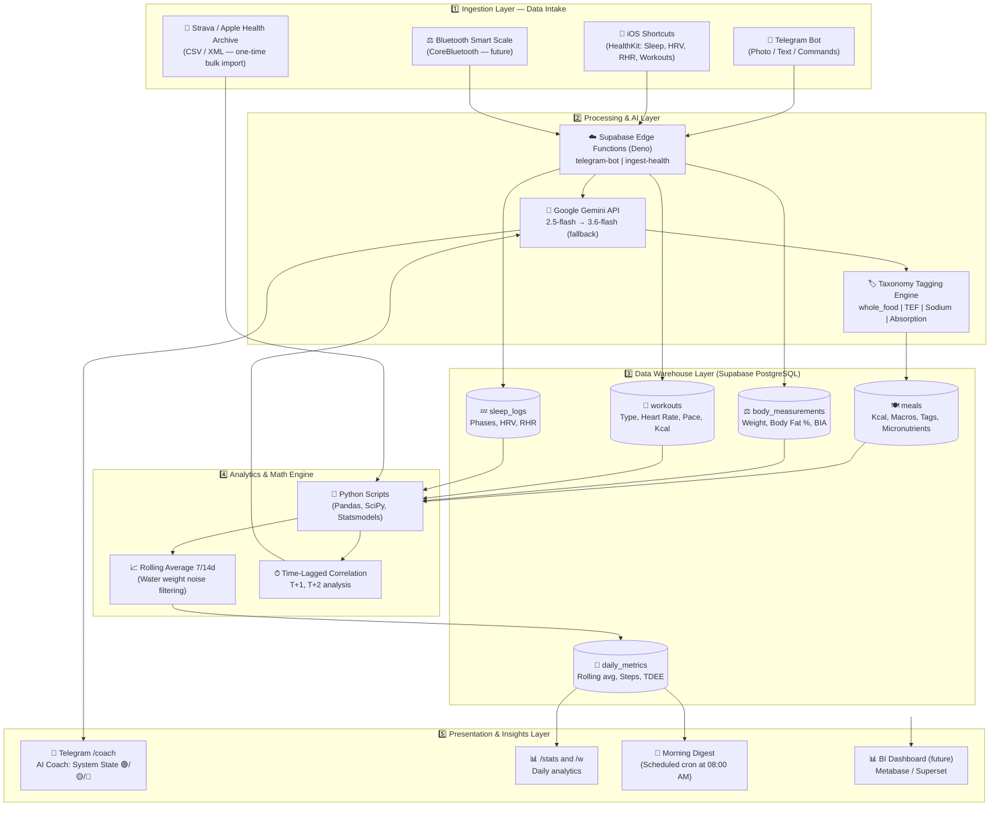

# Lifecore System Architecture
*(Quantified Self Health & Nutrition Data Warehouse)*

> Consolidated architectural vision: merged from `docs/ARCHITECTURE.md`, `Lifecore/docs/architecture_vision.md`, and `Lifecore/docs/Персональний AI-тренер у Telegram.md`.

---

## 1. Context and Problem Statement

Commercial health trackers (Cronometer, MyFitnessPal) suffer from severe **vendor lock-in**: they alter monetization models, gate features behind subscriptions, and block raw data exports. Fitness platforms like Strava and Apple Health remain isolated silos — Strava has no visibility into meal sodium levels before an endurance run, and Apple Health lacks food quality context.

**The Primary Goal of Lifecore:** Consolidate nutrition, physical training, sleep architecture, and body composition into a **single relational PostgreSQL database** to identify non-obvious causal links using AI and longitudinal statistical analysis.

---

## 2. Architecture Diagram (5-Layer System)

---

## 3. Detailed Layer Breakdown

### 3.1. Ingestion Layer — Data Intake

**Guiding Principle: Frictionless Input & Canonical Primary Source**

* **Canonical Primary Source:** **Apple Health / Apple Fitness** is the primary source of truth for all activity, workouts, sleep, and physiological telemetry. The Apple Watch passively records continuous biometric telemetry with zero user effort. Strava is an optional, secondary export channel.
* **Lifestyle & NEAT Tracking:** Non-exercise household activity (walking, errands, daily movement) is captured via HealthKit step counts and active energy, populating `daily_metrics`.

| Source | Data Collected | Method | Status |
|---|---|---|---|
| Telegram Bot | Food photos/text, morning weight (`/w`) | Webhook → Edge Function | ✅ Production |
| iOS Shortcuts (Apple Health) | Sleep stages, HRV, RHR, workouts, daily steps & active kcal | POST → `ingest-health` | 🔜 Phase 2 |
| Python Sync | Strava CSV + Apple Health XML archive | Supabase batch insert with deduplication | ✅ Implemented |
| Bluetooth Scale | Weight + Bioimpedance (BIA) | CoreBluetooth (future) | 📅 Future |

**Critical Rule — 4-Hour Day Shift:**
The dietary day resets at **04:00 AM**, not at midnight. Meals consumed after midnight and before 04:00 AM are attributed to the previous calendar day. This applies across all domain tables: `meals`, `workouts`, `sleep_logs`, and `daily_metrics`.

---

### 3.2. Processing & AI Layer

**Gemini Vision (Meal Recognition):**
- **Model:** `gemini-3.8-flash` (primary — state-of-the-art vision reasoning) → `gemini-2.5-flash` (fast fallback) → `gemini-3.6-flash`
- **Response Format:** `responseMimeType: "application/json"` — enforced on all requests
- **Deficit Buffer:** Calories multiplied by ×1.125 (+12.5% buffer), while protein, fat, and carbs remain exact
- **Quality Taxonomy:** `whole_food` | `ultra_processed` | `solid` | `liquid` | `fast_absorbing` | `slow_absorbing` | `high_sodium`
- **Micronutrients:** `fiber_g`, `sodium_mg`, `potassium_mg`, `vitamin_c_mg`, `iron_mg`, `calcium_mg`
- **Amino Acids (for high-protein meals):** `bcaa_g`, `leucine_g`

**Gemini Coach (Recovery & Readiness Analysis):**
- **Model:** `gemini-3.8-flash` (primary — high-order contextual synthesis) → `gemini-3.6-flash` (fallback)
- Receives pre-aggregated context from PostgreSQL: 3-day history of workouts, daily activity (steps/active kcal), sleep architecture, and nutrition
- Never receives raw unindexed dumps — operates on structured, pre-computed JSON
- Returns: `SYSTEM STATE: 🟢/🟡/🔴` with causal recovery insights

---

### 3.3. Data Warehouse Layer

Built on **PostgreSQL managed via Supabase**:
- Strict relational schema with foreign key relationships (`user_id` on all tables)
- Security: `ALLOWED_USER_ID` verified in application logic (Edge Function + Node.js)
- Composite indexes on `(user_id, dietary_date)` for fast aggregation
- Detailed schema reference: [DATABASE.md](./DATABASE.md)

---

### 3.4. Analytics & Math Engine

**Offline Python Scripts** (`Lifecore/scripts/`):

| Script | Purpose |
|---|---|
| `deep_health_analysis.py` | Streams Apple Health XML (1.97 GB) → `daily_health_summary.json` |
| `analyze_health.py` | Analyzes monthly HRV, RHR, and step trends |
| `analyze_steps.py` | Detects and corrects step double-counting (iPhone vs. Apple Watch) |
| `analyze_strava.py` | Computes pace, distance, and HR correlations from Strava activities |
| `sync_to_supabase.py` | Bulk-uploads historical archives into Supabase |

**Mathematical Foundations:**
- **Rolling Average:** $W_{7d}(t) = \frac{1}{7} \sum_{i=0}^{6} W(t-i)$ (filters out daily water retention noise)
- **Time-Lagged Correlation:** $Corr(X_t, Y_{t+\Delta t}), \Delta t \in \{1, 2, 3\}$ (e.g., sodium intake vs. next-day weight fluctuations)
- **Statistical Significance:** Enforces $p$-value $< 0.05$

---

### 3.5. Presentation & Insights Layer

| Interface | Implementation | Status |
|---|---|---|
| `/stats` — Daily Summary | Telegram Bot + inline date pagination buttons | ✅ Production |
| `/coach` — AI Recovery Coach | Telegram Bot + Gemini Context Engine | 🔜 Phase 2 |
| Morning Digest (08:00 AM) | Supabase Scheduled Cron Edge Function | 📅 Phase 3 |
| BI Analytics Dashboard | Metabase / Apache Superset → Supabase PostgreSQL | 📅 Phase 4 |

---

## 4. Edge Functions Map

| Function | Trigger | Action |
|---|---|---|
| `telegram-bot` | Telegram Webhook | Meal logging, stats aggregation, coach advice, weight tracking |
| `ingest-health` | iOS Shortcuts POST | Ingests sleep stages, HRV, RHR, and workout metrics |

---

## 5. Non-Negotiable Core Principles

1. **Data Ownership:** All data resides in a private PostgreSQL database with zero vendor lock-in.
2. **Frictionless Input:** Photo or short text — maximum 5 seconds per meal entry.
3. **Modularity:** Every layer is decoupled — swapping Gemini for Claude/GPT requires zero database schema changes.
4. **Evidence-Based AI:** The LLM receives pre-computed statistical facts and aggregated figures, never raw unparsed data.
5. **Deficit Discipline:** The +12.5% calorie buffer is non-negotiable unless explicitly altered by user directive.

---

## 6. Open Architecture Questions (Room for Thoughts)

* **Apple Health ↔ DB Parity:** Data conflict resolution — is Apple Health the absolute source of truth or simply one client?
* **Confidence Validation:** When `confidence < 60`, should an interactive UI trigger for manual portion adjustment?
* **Multi-User Scaling:** How to cleanly scale to secondary user profiles (e.g., Vika profile) — single bot with `user_id` routing vs. separate instances?
* **Bluetooth Scale Integration:** Automated CoreBluetooth weight capture without foreground app launch via SwiftUI background tasks.
