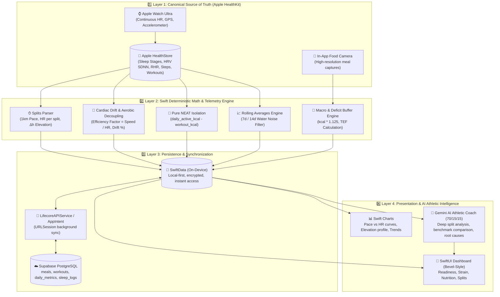

# Lifecore 2.0 System Architecture: Native iOS-First & Athletic Intelligence

> **Document Status:** Master Architecture Reference  
> **Target Platform:** Native iOS (Swift 6, SwiftUI, Swift Charts, HealthKit, SwiftData) + Cloud Synchronization (Supabase PostgreSQL, Gemini API)

---

## 1. Executive Architectural Summary

**Lifecore 2.0** represents an architectural shift from a multi-backend Telegram bot (Version 1.0) to a **native, on-device iOS-first platform**. 

Commercial health platforms (Whoop, Oura, Strava, MyFitnessPal) enforce vendor lock-in, fragment metrics across disparate apps, and fail to provide unified physiological intelligence. Lifecore consolidates continuous autonomic telemetry (Apple Watch), granular running split dynamics (HealthKit), and vision-based nutrition tracking into a cohesive, private, on-device ecosystem.

### Architectural Core Principles:
1. **Local-First & HealthKit as Canonical Truth:** Apple Health on iOS is the primary source of truth for all biological and physical telemetry. Telemetry is parsed directly on-device without third-party API dependencies.
2. **Deterministic Computation Precedes AI Synthesis:** All numerical calculations (1km splits, pace, heart rate decoupling, cardiac drift %, isolated NEAT, rolling averages) are calculated deterministically in Swift. The LLM is never tasked with raw arithmetic.
3. **Athletic Focus (70 / 15 / 15):** The AI Coach operates as an elite endurance performance analyst, focusing on workout execution and utilizing recovery metrics strictly to explain performance deltas.
4. **Cloud Backup Without Coupling:** Supabase PostgreSQL serves as a cloud synchronization warehouse and historical cold storage, allowing the iOS app to function seamlessly offline.

---

## 2. 4-Layer On-Device Architecture

---

## 3. Detailed Layer Specifications

### 3.1. Layer 1: Ingestion & Canonical Telemetry
* **Technology:** Apple HealthKit framework (`HKHealthStore`), AVFoundation (camera).
* **Guiding Rule:** The Apple Watch passively records high-frequency physiological telemetry with zero user friction.
* **Telemetry Collected:**
  - **Sleep Architecture:** Categorized durations in `asleepDeep`, `asleepREM`, `asleepCore`, and `awake`.
  - **Autonomic Readiness:** Morning HRV (SDNN) and resting heart rate (RHR).
  - **Workouts:** `HKWorkout` sessions, route coordinate samples (`HKWorkoutRoute`), and instant heart rate samples (`HKQuantityTypeIdentifierHeartRate`).
  - **Daily Activity:** Cumulative step count and active energy burned.

---

### 3.2. Layer 2: Swift Deterministic Math & Telemetry Engine
* **Technology:** Swift 6 concurrency, SIMD / native vector algorithms.
* **Separation of Concerns:** Zero arithmetic is delegated to the LLM. Swift executes all formulas:
  1. **Kilometer Splits:** Extracts raw distance and timestamp samples into discrete 1000m windows, computing exact pace, average HR, and elevation delta ($\Delta h$).
  2. **Cardiac Drift & Decoupling:**
     $$\text{Efficiency Factor } (EF) = \frac{\text{Speed (m/min)}}{\text{Average Heart Rate (bpm)}}$$
     $$\text{Cardiac Drift } (\%) = \left(\frac{EF_{\text{1st half}} - EF_{\text{2nd half}}}{EF_{\text{1st half}}}\right) \times 100\%$$
  3. **Pure NEAT Isolation:**
     $$\text{NEAT}_{\text{kcal}} = \max(0, \text{daily\_active\_kcal} - \sum \text{workout\_kcal})$$
  4. **Deficit Buffer Discipline:** Multiplies raw food calories by $\times 1.125$ to compensate for unlogged cooking oils and portion variance.

---

### 3.3. Layer 3: Persistence & Synchronization Layer
* **Local Persistence (SwiftData):** Local-first encrypted storage for `@Model` entities (`MealEntity`, `WorkoutEntity`, `DailyMetricEntity`, `SleepLogEntity`). Enables instant app startup (<5ms) and full offline functionality.
* **Cloud Persistence & Backup (Supabase PostgreSQL):**
  - Asynchronous cloud backup ensuring longitudinal data longevity (10+ years).
  - Key tables: `meals` (nutrition warehouse) and `workout_analyses` (stores 1km splits and structured laps as `JSONB`, alongside AI performance reports).
  - Background synchronization triggered via `LifecoreSyncIntent` / `URLSession` on morning wake-up and workout completion.
  - Ingestion endpoint: `ingest-health` Edge Function.

---

### 3.4. Layer 4: Presentation & AI Athletic Intelligence
* **Presentation Layer (SwiftUI Dark-Mode Dashboard):**
  - **Today View:** Bevel-style rings for Readiness (0-100%), Cardiovascular Strain (0-100%), and Caloric Balance.
  - **Workouts View:** Slices runs into 1km auto-splits and interval laps; synchronized Swift Charts for pace, heart rate, and elevation profile.
  - **Nutrition View:** Optimistic photo capture (<0.2s UI response), portion and macro breakdown with +12.5% deficit buffer.
  - **Trends View:** 7-day and 14-day rolling body weight averages (filtering water/glycogen noise), long-term HRV/RHR trajectories.
* **AI Athletic Coach (Gemini API direct service):**
  - Evaluates pre-calculated Swift telemetry payload.
  - Strictly follows the **70 / 15 / 15** athletic performance framework:
    - **70%:** Granular execution breakdown of 1km splits, pacing stability, HR vs elevation ($\Delta h$), and cardiac drift.
    - **15%:** Historical benchmark comparison against previous similar sessions.
    - **15%:** Physiological root causes (sleep stages, HRV/RHR, pre-run nutrition) + 1 tactical athletic directive for the next 24h.
  - **Zero Alarmism:** No unsolicited generic wellness advice; normal athletic RHR variations are treated as standard training adaptations.

---

## 4. Status of Legacy Telegram Components (Version 1.0)

| Component | Path | Status | Notes |
|---|---|---|---|
| Node.js Long Polling | `index.js`, `handlers/`, `utils/` (`legacy_telegram/`) | ⚠️ **Legacy / Deprecated** | Retained for reference; feature development discontinued |
| Deno Telegram Webhook | `supabase/functions/telegram-bot/` (`legacy_telegram/`) | ⚠️ **Legacy / Deprecated** | Secondary Telegram interface only; no dual-sync |
| Offline Python Analytics | `Lifecore/scripts/` | ✅ **Archival Reference** | Historical XML parser and data migration |
