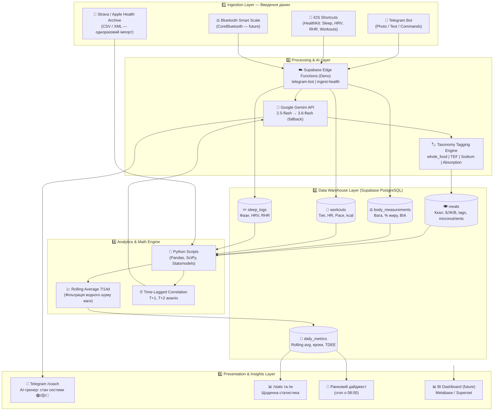

# Lifecore System Architecture
*(Quantified Self Health & Nutrition Data Warehouse)*

> Об'єднаний документ архітектурного бачення: злиття `docs/ARCHITECTURE.md`, `Lifecore/docs/architecture_vision.md` та `Lifecore/docs/Персональний AI-тренер у Telegram.md`.

---

## 1. Контекст та проблема

Комерційні трекери (Cronometer, MyFitnessPal) страждають від **vendor lock-in**: змінюють монетизацію, обрізають функції, не дають доступу до raw-даних. Стравa та Apple Health є ізольованими сайлосами — вони не знають, скільки натрію ти з'їв перед пробіжкою.

**Головна мета Lifecore:** зібрати харчування, тренування, сон і склад тіла в **одну реляційну базу даних** і знаходити неочевидні причинно-наслідкові зв'язки між ними за допомогою AI та статистичного аналізу.

---

## 2. Архітектурна діаграма (5-рівнева система)

---

## 3. Детальний опис шарів

### 3.1. Ingestion Layer — Введення даних

**Принцип: Frictionless Input (нульовий поріг входу)**

| Джерело | Що передає | Метод | Статус |
|---|---|---|---|
| Telegram Bot | Фото/текст їжі, вага (/w) | Webhook → Edge Function | ✅ Prod |
| iOS Shortcuts | Сон, HRV, RHR, тренування | POST → `ingest-health` | 🔜 |
| Python sync | Strava CSV + Apple Health XML | Direct Supabase insert | 🔜 |
| Bluetooth Scale | Вага + BIA | CoreBluetooth (future) | 📅 Future |

**Критичне правило — 4-годинний зсув:**
День змінюється о **04:00 AM**, а не опівночі. Їжа після північ і до 04:00 зараховується до попереднього дня. Це стосується всіх таблиць: `meals`, `workouts`, `sleep_logs`.

---

### 3.2. Processing & AI Layer

**Gemini Vision (розпізнавання їжі):**
- Модель: `gemini-2.5-flash` (основна) → `gemini-3.6-flash` (fallback при 503)
- Формат відповіді: `responseMimeType: "application/json"` — завжди
- **Deficit Buffer:** Ккал × 1.125 (+12.5%), макроси — точні
- Таксономія якості: `whole_food` | `ultra_processed` | `solid` | `liquid` | `fast_absorbing` | `slow_absorbing` | `high_sodium`
- Мікронутрієнти: `fiber_g`, `sodium_mg`, `potassium_mg`, `vitamin_c_mg`, `iron_mg`, `calcium_mg`
- Амінокислоти (для білкових страв): `bcaa_g`, `leucine_g`

**Gemini Coach (аналіз відновлення):**
- Отримує агрегований контекст з БД: 3 дні тренувань + сон + харчування
- НЕ отримує сирі цифри — отримує підготовлений структурований JSON
- Повертає: `СТАН СИСТЕМИ: 🟢/🟡/🔴` + причинно-наслідкові інсайти

---

### 3.3. Data Warehouse Layer

Побудований на **PostgreSQL через Supabase**:
- Реляційна структура з FK-зв'язками (user_id скрізь)
- Безпека: ALLOWED_USER_ID перевіряється на рівні коду (Edge Function + Node.js)
- Індекси: `(user_id, dietary_date)` для миттєвих агрегацій
- Детальна схема: [DATABASE.md](./DATABASE.md)

---

### 3.4. Analytics Engine

**Офлайн Python-скрипти** (`Lifecore/scripts/`):

| Скрипт | Що робить |
|---|---|
| `deep_health_analysis.py` | Парсить Apple Health XML → `daily_health_summary.json` |
| `analyze_health.py` | Тренди HRV/RHR/Steps по місяцях |
| `analyze_steps.py` | Перевірка подвійного підрахунку кроків |
| `analyze_strava.py` | Темп, дистанції, кореляції Strava |
| `sync_to_supabase.py` | Завантаження архіву в БД |

**Математика:**
- Rolling Average: $W_{7d}(t) = \frac{1}{7} \sum_{i=0}^{6} W(t-i)$ (фільтрація водного шуму)
- Time-Lag Correlation: $Corr(X_t, Y_{t+\Delta t}), \Delta t \in \{1, 2, 3\}$ (натрій → вага наступного дня)
- Statistical validation: $p$-value $< 0.05$

---

### 3.5. Presentation Layer

| Інтерфейс | Реалізація | Статус |
|---|---|---|
| `/stats` — щоденна статистика | Telegram + inline кнопки | ✅ |
| `/coach` — AI-аналіз відновлення | Telegram + Gemini | 🔜 |
| Ранковий дайджест о 08:00 | Supabase cron | 📅 Phase 3 |
| BI Dashboard | Metabase/Superset → Supabase | 📅 Phase 4 |

---

## 4. Edge Functions Map

| Function | Trigger | Дія |
|---|---|---|
| `telegram-bot` | Telegram Webhook | Food logging, stats, coach, weight |
| `ingest-health` | iOS Shortcuts POST | Save sleep + workout data |

---

## 5. Ключові принципи (непорушні)

1. **Data Ownership:** Всі дані у власній PostgreSQL, без vendor lock-in
2. **Frictionless Input:** Фото або короткий текст — максимум 5 секунд на запис
3. **Modularity:** Кожен шар незалежний — можна замінити Gemini на GPT-4V без переписування БД
4. **AI не вигадує числа:** LLM отримує готові статистичні факти, а не сирі таблиці
5. **Deficit Discipline:** +12.5% buffer незмінний, якщо користувач явно не попросив інакше

---

## 6. Відкриті питання (Room for thoughts)

* **Apple Health ↔ БД:** Суперечність даних? Apple Health — source of truth чи лише один із клієнтів?
* **Confidence validation:** При `confidence < 60` — потрібен UI для ручного коригування порції?
* **Multi-user:** Як масштабувати на другого користувача (Віка-профіль) — один бот, різні user_id?
* **Bluetooth Scale:** CoreBluetooth автоматизація без відкриття нативного додатку — SwiftUI app?
