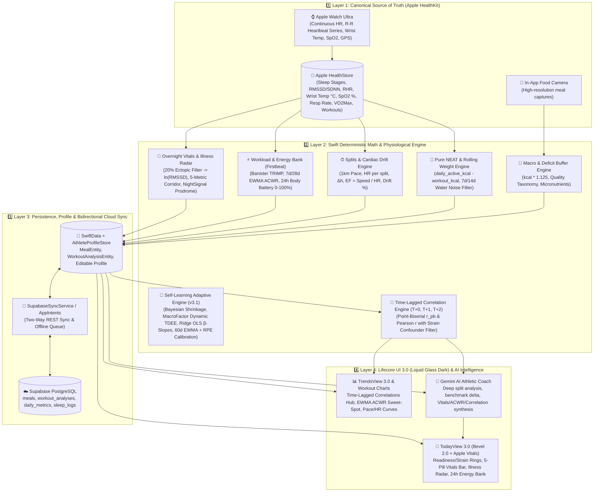

# Lifecore 2.0 System Architecture: Native iOS-First & Athletic Intelligence

> **Document Status:** Master Architecture Reference  
> **Target Platform:** Native iOS (Swift 6, SwiftUI, Swift Charts, HealthKit, SwiftData) + Cloud Synchronization (Supabase PostgreSQL, Gemini API)

---

## 1. Executive Architectural Summary

**Lifecore 2.0** represents an architectural shift from a multi-backend Telegram bot (Version 1.0) to a **native, on-device iOS-first platform**. 

Commercial health platforms (Whoop, Oura, Strava, MyFitnessPal) enforce vendor lock-in, fragment metrics across disparate apps, and fail to provide unified physiological intelligence. Lifecore consolidates continuous autonomic telemetry (Apple Watch), granular running split dynamics (HealthKit), and vision-based nutrition tracking into a cohesive, private, on-device ecosystem.

### Architectural Core Principles:
1. **Local-First & HealthKit as Canonical Truth:** Apple Health on iOS is the primary source of truth for all biological and physical telemetry. Telemetry is parsed directly on-device without third-party API dependencies.
2. **Deterministic Computation Precedes AI Synthesis:** All numerical calculations (1km splits, pace, heart rate decoupling, cardiac drift %, isolated NEAT, rolling averages) are calculated deterministically in Swift. The LLM is never tasked with raw arithmetic.
3. **Athletic Focus (70 / 15 / 15):** The AI Coach operates as an elite endurance performance analyst, focusing on workout execution and utilizing recovery metrics strictly to explain performance deltas.
4. **Cloud Backup Without Coupling:** Supabase PostgreSQL serves as a cloud synchronization warehouse and historical cold storage, allowing the iOS app to function seamlessly offline.

---

## 2. 4-Layer On-Device Architecture (Lifecore 2.0 & 3.0 Engine)

---

## 3. Detailed Layer Specifications

### 3.1. Layer 1: Ingestion & Canonical Telemetry
* **Technology:** Apple HealthKit framework (`HKHealthStore`, `HKHeartbeatSeriesQuery`, `HKStatisticsQuery`), AVFoundation (camera).
* **Guiding Rule:** The Apple Watch passively records high-frequency physiological telemetry with zero user friction.
* **Telemetry Collected:**
  - **Sleep Architecture:** Categorized durations in `asleepDeep`, `asleepREM`, `asleepCore`, and `awake`, plus sleep efficiency and 14-day circadian consistency.
  - **5-Metric Overnight Vitals:**
    1. **Beat-to-Beat HRV (`HKHeartbeatSeriesSample` & `.heartRateVariabilitySDNN`):** Raw R-R intervals filtered for ectopic artifacts (>20% jump rejected) to compute $\text{RMSSD}$, with automatic fallback to nocturnal `SDNN`.
    2. **Sleeping Resting Heart Rate (`.restingHeartRate`):** Nocturnal RHR baseline.
    3. **Sleeping Wrist Temperature (`.appleSleepingWristTemperature`):** Nocturnal skin temperature delta ($\Delta T^\circ\text{C}$) against 30/60-day personal baseline.
    4. **Sleeping Respiratory Rate (`.respiratoryRate`):** Nocturnal breaths per minute.
    5. **Blood Oxygen Saturation (`.oxygenSaturation`):** Overnight capillary $\text{SpO}_2\%$.
  - **Cardiorespiratory Fitness & Workouts:** `HKWorkout` sessions, continuous heart rate/distance/altitude series, structured `HKWorkoutActivity` interval laps, and `.vo2Max`.
  - **Daily Activity:** Cumulative step count, active energy burned, and scale body mass (`.bodyMass`).

---

### 3.2. Layer 2: Swift Deterministic Math & Physiological Engine
* **Technology:** Swift 6 concurrency, deterministic statistical and physiological modeling (`Lifecore/Core/MathEngine/`).
* **Separation of Concerns:** Zero arithmetic or statistical correlation is delegated to the LLM. Swift executes all formulas:
  1. **Kilometer Splits & Cardiac Drift:** Extracts raw distance and timestamp samples into discrete 1000m windows with linear boundary interpolation, computing exact pace, average HR, elevation delta ($\Delta h$), Efficiency Factor ($EF = \text{Speed} / \text{HR}$), and Cardiac Drift %.
  2. **Log-Transformed HRV & 5-Metric Overnight Vitals Confluence (`VitalsAndIllnessEngine.swift`):**
     - Normalizes skewed HRV via natural logarithm: $Z_{\text{HRV}} = (\ln\text{HRV}_t - \mu_{\ln, 60d}) / \sigma_{\ln, 60d}$.
     - Evaluates all 5 nocturnal pillars against personal rolling corridors and runs the **Stanford NightSignal + Apple Vitals** confluence classifier (`optimal`, `trainingFatigue`, `immuneWatch`, `illnessProdrome`) to flag viral/inflammatory prodrome 24–48h before symptoms while preventing false alarms on 1-metric training fatigue.
  3. **Garmin Firstbeat Workload & Continuous Energy Bank (`TrainingLoadAndBatteryEngine.swift`):**
     - **Banister TRIMP:** $\text{TRIMP} = D_{\text{min}} \cdot \Delta\text{HR}_r \cdot 0.64 \cdot e^{1.92 \cdot \Delta\text{HR}_r}$.
     - **EWMA ACWR:** Acute 7-day ($\lambda_a = 2/8$) vs Chronic 28-day ($\lambda_c = 2/29$) Exponentially Weighted Moving Average ratio, targeting the $0.80\text{--}1.30$ progressive overload sweet spot.
     - **Body Battery / Energy Bank (0–100%):** Hourly differential trajectory from wake-up to bedtime combining sleep recharge and daytime sympathetic/metabolic drain.
  4. **Confounder-Controlled Time-Lagged Correlation Engine (`CorrelationEngine.swift`):**
     - Computes Point-Biserial ($r_{pb}$) and Pearson ($r$) correlations across $T+0, T+1, T+2$ lags (e.g., Sodium $\to$ next-day water weight spike; Late meal / UPF $\to$ overnight HRV drop excluding high-TRIMP days; Pre-run carbs $\to$ Cardiac Drift %).
  5. **Pure NEAT Isolation & Deficit Buffer Discipline:**
     - $\text{NEAT}_{\text{kcal}} = \max(0, \text{daily\_active\_kcal} - \sum \text{workout\_kcal})$.
     - Multiplies raw food calories by $\times 1.125$ to compensate for hidden cooking oils and portion variance.

---

### 3.3. Layer 3: Persistence, Profile & Synchronization Layer
* **Local Persistence (SwiftData & `AthleteProfileStore`):**
  - Lean `@Model` entities (`MealEntity`, `WorkoutAnalysisEntity`) for app-generated data, while raw biometrics are queried directly from HealthKit in <5ms.
  - `AthleteProfileStore` provides user-editable physiological baselines, BMR, Active Move goals, macro targets, and `hybridRMSSD` vs `appleSDNN` selection.
* **Bidirectional Cloud Warehouse (Supabase PostgreSQL):**
  - Asynchronous cloud backup ensuring longitudinal data longevity (10+ years) across `meals`, `workout_analyses`, `daily_metrics`, and `sleep_logs`.
  - Direct native iOS REST client (`SupabaseSyncService.swift`) supporting both background push and two-way cloud hydration (`pullHistoricalDataIfNeeded()`) on fresh installs.

---

### 3.4. Layer 4: Presentation (Lifecore UI 3.0) & AI Athletic Intelligence
* **Presentation Layer (`LifecoreDesignSystem` — Liquid Glass Dark / Bevel 2.0 Aesthetic):**
  - **Today View 3.0:** Readiness, Strain (with ACWR badge), and Active Move rings; **5-Pill Overnight Vitals Corridor Bar** with **Illness Prodrome Radar Banner**; **24h Energy Bank (Body Battery)** curve; Sleep Architecture & Sleep Debt; Movement & Pure NEAT with real-time accrued BMR; and `AthleteProfileSheet`.
  - **Workouts View:** 1km auto-splits and interval laps; synchronized Swift Charts for pace, heart rate, and elevation profile; EF, Cardiac Drift %, and Benchmark Delta cards.
  - **Nutrition View:** Optimistic photo/voice capture (<0.2s UI response), +12.5% deficit buffer, Whole Food vs UPF quality card, sodium water-retention warning, and leucine MPS threshold.
  - **Trends View 3.0:** 7d/14d rolling body weight trend (water noise filter), 30d/60d autonomic baseline corridors, **Time-Lagged Correlations & Insights Hub** ($r, r_{pb}$ with $T+1/T+2$ badges), and **EWMA ACWR Workload Ratio Chart**.
* **AI Athletic Coach (Gemini API direct service):**
  - Evaluates pre-calculated Swift telemetry, Overnight Vitals confluence, EWMA ACWR, and personal time-lagged correlations.
  - Delivers human, motivating Ukrainian debriefs across 3 clear sections (`Як пройшов забіг`, `Твій прогрес`, `Що робити далі (план на 24г)`) with zero medical alarmism on normal training adaptations.

---

## 4. Status of Legacy Telegram Components (Version 1.0 Archive)

All Version 1.0 components have been completely removed from `main` and safely archived in git tag `v1.0-telegram-archive`:

| Component | Historical Path | Status | Notes |
|---|---|---|---|
| Node.js Long Polling | `index.js`, `handlers/`, `utils/` | 📦 **Archived in Tag** | Archived in `v1.0-telegram-archive` |
| Deno Telegram Webhook | `supabase/functions/telegram-bot/` | 📦 **Archived in Tag** | Archived in `v1.0-telegram-archive` |
| Ingestion Webhook | `supabase/functions/ingest-health/` | 📦 **Archived in Tag** | Replaced by direct iOS client sync |
| Offline Python Analytics | `Lifecore/scripts/` | 📦 **Archived in Tag** | Historical XML parser & Strava scripts |

