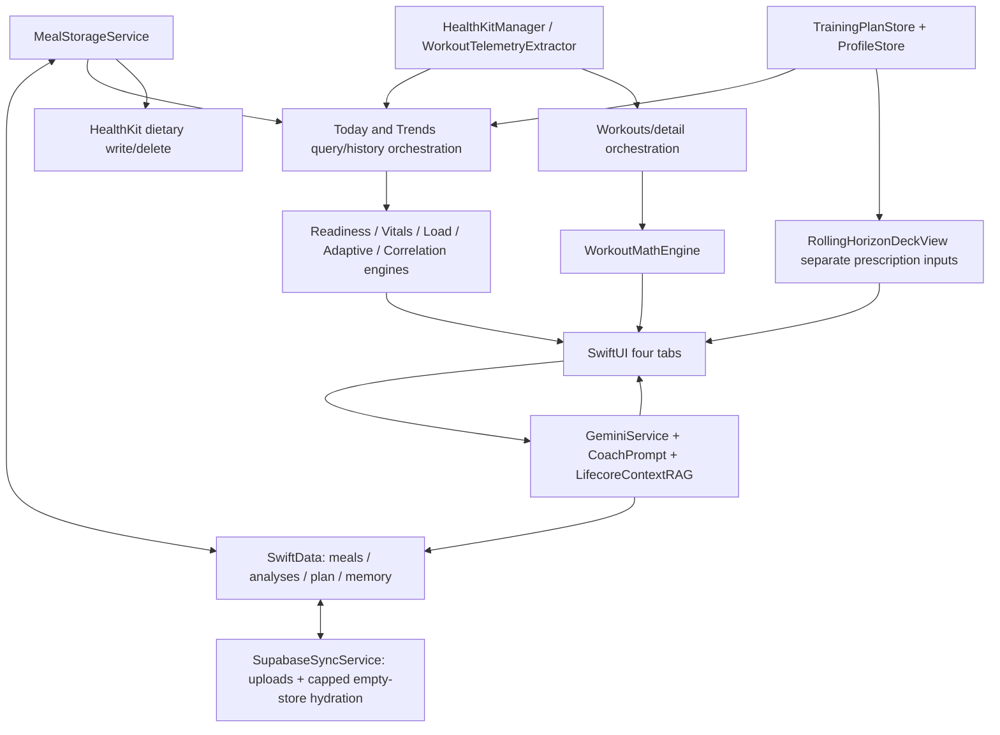

# Lifecore architecture

Updated:2026-11-12. This document describes checked-in behavior at audit baseline `3e6b998`; the [redesign specification](superpowers/specs/2026-11-12-native-redesign-design.md) describes the proposed target. No application architecture changed in the documentation audit.

## Product and platform

Lifecore combines workout telemetry, recovery context and nutrition into athletic decisions. Native iOS remains the primary client and math engine. SwiftUI/Charts present four tabs; HealthKit reads device data; SwiftData persists local records; Supabase REST uploads data and provides partial initial hydration; Gemini supplies recognition and narrative.

Actual project settings:iOS 27.0 deployment floor, Swift 5.0 language mode, verified Xcode 27.1 toolchain. Existing documentation's Swift 6/iOS17+/Xcode16+ claims did not match the project. Swift 6 migration is planned and currently exposes actor-isolation warnings.

## Current component/data flow

Singleton services and feature-level orchestration are the actual dependency boundary. Today and Trends independently build physiological histories; Workouts separately generates advice. The current flow is not one canonical evaluated snapshot.

## Responsibilities and verified limitations

- **Health ingestion:** queries sleep/activity/workouts/history and builds TodaySnapshot. Sparse/unavailable histories can generate demo-like data; latest-ever independent biomarkers and baseline substitutions can masquerade as one night. Workout extraction loses the first interval and lacks reliable elevation handling. See F01/F04/F13/F14.
- **Deterministic engines:** isolated Swift calculations are a reusable foundation. Call-site inputs undermine Today ACWR/battery and adaptive/correlation outputs; correlation narrative can contradict its sign. Preserve formulas only with dated/provenance-aware inputs and tests, not assumed clinical validity.
- **Storage:** SwiftData models are MealEntity, WorkoutAnalysisEntity, AthleteTrainingPlanState and AthleteMemoryEntity. Profile calibration uses UserDefaults. Persistent-container failure falls back to memory; save errors and legacy migration failures can be hidden. No durable revisioned outbox exists.
- **Cloud:** uploads use direct REST. Pull occurs only for empty collections, capped60 meals/30 analyses; workout pull names differ from SQL/upload. No complete incremental reconciliation/tombstone protocol exists. Deployed policies/ownership protection were not verified.
- **AI:** qualitative narrative is intended to consume deterministic evidence, but live calorie-buffer arithmetic is delegated to the prompt; error fallbacks fabricate data. RAG meal totals have inconsistent time-window labels. AI memory currently needs a clearer confirmation/provenance lifecycle.
- **Presentation:** current Daylight design forces light mode. Dense component stacks, independent state calculation and missing error states are the main redesign concerns. Exact visual/accessibility defects require runtime inspection.
- **Verification:** thirteen Debug-startup verification groups only log; five Maestro smoke flows mostly inspect visibility/navigation. No XCTest target/test scheme action exists at baseline. Build passes with warnings; correctness/clinical/performance claims are not established by build success.

## Required invariants

Deterministic Swift arithmetic precedes AI explanation. Ukrainian end-user copy; English prompts/code/docs. Native calorie buffer is exactly12.5% once, macros unchanged. Dietary attribution uses04:00; sleep has a separate bounded episode. Missing is not zero/normal. Preserve project multi-metric confluence rather than alarm on one ordinary RHR variation. Data must retain source/time/coverage and cannot silently become measured from a fixture or prior.

## Planned boundaries and rollout

R1/R2 establish executable tests and shared contracts. HealthRepository and PhysiologyHistoryBuilder supply measured optional inputs to engines; DailySnapshotCoordinator publishes a revisioned result; TrainingPrescriptionService creates one plan; view models consume these results. Durable MealRepository/outbox and typed cloud DTOs preserve identity, revisions and recoverability. AI adapters validate payloads and evidence. Explicit fixture composition disables real exports.

The [master plan](superpowers/plans/2026-11-12-native-redesign.md) assigns exclusive file owners, dependencies, regression cases and integration gates. Screens migrate after shared contracts; no new backend/platform rewrite is proposed. Future migrations are additive and tested before production deployment. Audit findings stay open until evidence resolves them.

## References

[Audit with source anchors](audits/2026-11-12-architecture-and-product-audit.md), [database contract](DATABASE.md), [roadmap](ROADMAP.md), [design specification](superpowers/specs/2026-11-12-native-redesign-design.md). Historical October specs remain design history and are not proof of current correctness.
