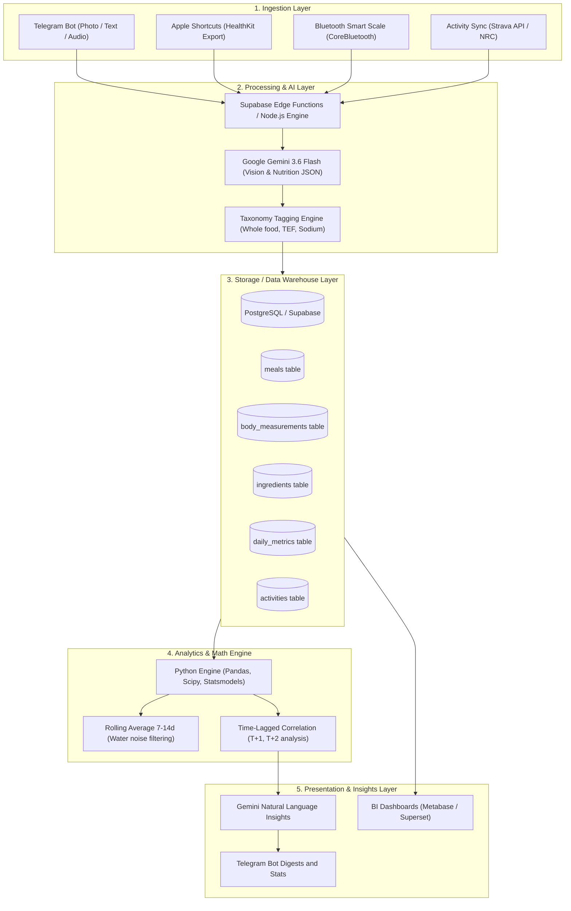

# Lifecore System Architecture
*(Quantified Self Health & Nutrition Data Warehouse)*

## 1. System Overview

Lifecore is a personal modular system for collecting, storing, and intelligently analyzing health metrics. 
The system is built as a **multi-layer Data Warehouse platform**:

---

## 2. Layer Details

### 2.1. Ingestion Layer
The main principle is **Frictionless (Zero Barrier)**:
1. **Telegram Bot (Food Input):**
   - User sends a photo of a dish right before eating.
   - Optionally adds a text or voice comment (e.g., *"there are 2 eggs here, fried in 5g of butter"*).
   - Supports quick day correction: `/y` command prefix for logging food retroactively (yesterday's diet).
2. **Apple Shortcuts (Sleep & Activity Metrics Collection):**
   - An iOS automation is set up that pulls from Apple Health every morning (e.g., at 08:30):
     - Total sleep time, sleep phases (Deep, REM, Core).
     - Resting Heart Rate and HRV.
     - Steps count and Active Energy burned yesterday.
     - Morning weight (if entered manually or from scale).
   - The shortcut sends a POST JSON to the Supabase webhook.
3. **Smart Scales (Body Composition):**
   - Retrieves weight, impedance (% water, fat mass, bone mass).
   - In later stages: native background collection via SwiftUI app.

---

### 2.2. Processing & AI Layer
1. **Multimodal Vision:**
   - Model: `gemini-3.6-flash`.
   - Mode: strict `responseMimeType: "application/json"`.
   - The prompt controls:
     - Assessing the depth and scale of the plate (not overestimating restaurant portions).
     - Calculating cooked food (Cooked weight vs Dry weight).
     - **Deficit Buffer (+15% to calories):** artificially inflating calories while keeping exact macros (protein, fats, carbs).
2. **Taxonomy & Tagging Engine:**
   - Automatic metadata assignment:
     - `whole_food` vs `ultra_processed`
     - `solid` vs `liquid`
     - `fast_absorbing` vs `slow_absorbing`
     - `high_sodium`

---

### 2.3. Data Warehouse Layer
Built on managed **PostgreSQL in Supabase**:
* **Relational model:** Instead of isolated logs, a linked schema is formed between meals, ingredients, workouts, and daily biometric metrics.
* **Security:** Row Level Security (RLS) at the `user_id` level.
* **Indexing:** Composite indexes `(user_id, dietary_date)` for instant aggregations.

---

### 2.4. Analytics Engine
The system does not allow AI to hallucinate over raw numbers. The Python math layer processes data algorithmically:
1. **Rolling Averages Smoothing:**
   $$W_{7d}(t) = \frac{1}{7} \sum_{i=0}^{6} W(t-i)$$
   $$W_{14d}(t) = \frac{1}{14} \sum_{i=0}^{13} W(t-i)$$
   This eliminates the 1–2 kg water fluctuations from glycogen or cortisol.
2. **Time Lags Analysis:**
   Calculating body reaction delay:
   $$\text{Corr}(X_t, Y_{t + \Delta t}), \quad \Delta t \in \{1, 2, 3\}$$
   where $X_t$ is, for example, the amount of sodium or carbs on day $t$, and $Y_{t + \Delta t}$ is the morning weight or running pace.
3. **Statistical Validation:**
   Filtering out noise via $p$-value ($p < 0.05$).

---

### 2.5. AI Insights & Presentation Layer
* After receiving mathematically proven facts, the LLM translates them into plain human language:
  > *"Over the last 14 days, your average weight decreased by 350g/week (trend is normal). Yesterday's meal contained high salt (+850g water retention today) — this is not fat, your weight will normalize within 48 hours."*
* Daily morning or evening reports are sent directly to Telegram.
