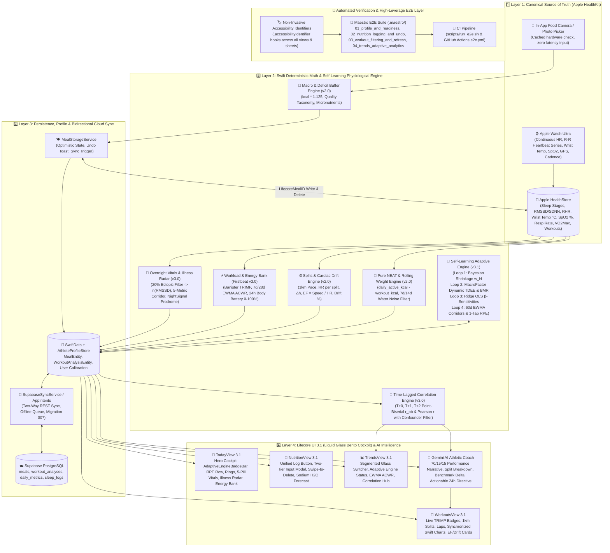

# Lifecore 3.1 System Architecture: Native iOS-First, Self-Learning Physiology & Athletic Intelligence

> **Document Status:** Master Architecture Reference (Active v3.1)  
> **Target Platform:** Native iOS (Swift 6, SwiftUI, Swift Charts, HealthKit, SwiftData) + Cloud Synchronization (Supabase PostgreSQL, Gemini API) + Maestro E2E

---

## 1. Executive Architectural Summary

**Lifecore 3.1** represents the evolution of the Lifecore platform from an initial multi-backend Telegram prototype (v1.0) into a **native, on-device iOS-first quantified self and athletic performance ecosystem** (v2.0), elevated with **clinical-grade physiological intelligence** (v3.0), and culminating in a **self-learning adaptive physiology engine and Liquid Glass Bento UI overhaul** (v3.1).

Commercial health platforms (Whoop, Oura, Strava, MyFitnessPal) enforce vendor lock-in, fragment metrics across disparate apps, and fail to provide unified physiological intelligence. Lifecore consolidates continuous autonomic telemetry (Apple Watch), granular running split dynamics (HealthKit), and vision-based nutrition tracking into a cohesive, private, on-device ecosystem.

### Architectural Core Principles:
1. **Local-First & HealthKit as Canonical Truth:** Apple Health on iOS is the primary source of truth for all biological and physical telemetry. Telemetry is parsed directly on-device in <5ms without third-party API dependencies.
2. **Deterministic Computation Precedes AI Synthesis:** All numerical calculations (1km splits, pace, heart rate decoupling, cardiac drift %, isolated NEAT, rolling averages, Banister TRIMP, EWMA ACWR, Bayesian shrinkage, dynamic TDEE, Ridge OLS slopes) are calculated deterministically in Swift. The LLM is never tasked with raw arithmetic.
3. **Athletic Focus (70 / 15 / 15):** The AI Coach operates as an elite endurance performance analyst, focusing on workout execution and utilizing recovery metrics strictly to explain performance deltas without medical alarmism.
4. **Cloud Backup Without Coupling:** Supabase PostgreSQL serves as a cloud synchronization warehouse and historical cold storage (10+ years), allowing the iOS app to function seamlessly offline.
5. **Bidirectional Dietary Consistency:** Ingested nutrition writes back to Apple Health with unique metadata keys (`LifecoreMealID`), maintaining sample synchronization across creation, in-place deletion, and restoration.
6. **Deterministic High-Leverage E2E Verification:** Automated Maestro UI tests assert full state persistence, mathematical computations, and non-blocking interactions directly against iOS simulators.

---

## 2. 4-Layer On-Device Architecture (Lifecore 3.1 Engine)

---

## 3. Detailed Layer Specifications

### 3.1. Layer 1: Ingestion & Canonical Telemetry
* **Technology:** Apple HealthKit framework (`HKHealthStore`, `HKHeartbeatSeriesQuery`, `HKQuantitySeriesSampleQuery`, `HKStatisticsQuery`), AVFoundation & PhotosUI (compact two-tier picker).
* **Guiding Rule:** Apple Watch passively captures continuous telemetry with zero user friction; queries execute on-device in <5ms.
* **Telemetry Collected:**
  - **Sleep Architecture:** Explicit durations in `asleepDeep`, `asleepREM`, `asleepCore`, and `awake`, plus sleep efficiency and 14-day circadian consistency.
  - **5-Metric Overnight Vitals Corridor:**
    1. **Beat-to-Beat HRV (`HKHeartbeatSeriesSample` & `.heartRateVariabilitySDNN`):** Raw R-R intervals filtered for ectopic artifacts (>20% interval jump rejected) to calculate $\text{RMSSD}$, falling back to log-transformed nocturnal $\text{SDNN}$.
    2. **Sleeping Resting Heart Rate (`.restingHeartRate`):** Basal nocturnal heart rate.
    3. **Sleeping Wrist Temperature (`.appleSleepingWristTemperature`):** Nocturnal wrist temperature delta ($\Delta T^\circ\text{C}$) against baseline.
    4. **Sleeping Respiratory Rate (`.respiratoryRate`):** Nocturnal breaths per minute.
    5. **Blood Oxygen Saturation (`.oxygenSaturation`):** Overnight capillary $\text{SpO}_2\%$.
  - **Cardiorespiratory Fitness & Workouts:** `HKWorkout` sessions, continuous heart rate/distance/altitude/cadence series, structured `HKWorkoutActivity` interval laps, and `.vo2Max`.
  - **Daily Activity:** Steps, active energy burned, and scale body mass (`.bodyMass`).
* **Bidirectional Nutrition Sync:**
  - Dietary energy, protein, fat, carbohydrates, fiber, and sodium written directly to Apple HealthKit.
  - Every dietary sample is tagged with metadata key `LifecoreMealID = meal.id.uuidString`.
  - Targeted deletion (`deleteMealFromHealthKit(mealId:)`) and undo restoration maintain strict 1-to-1 sync between HealthKit and Lifecore.

---

### 3.2. Layer 2: Swift Deterministic Math & Self-Learning Physiological Engine
* **Technology:** Swift 6 concurrency, deterministic statistical and physiological modeling (`Lifecore/Core/MathEngine/`).
* **Strict Separation:** Zero arithmetic, statistical correlations, or baseline modeling are delegated to the LLM. Swift executes all mathematics:

#### 1. Kilometer Splits & Cardiac Drift (`WorkoutMathEngine.swift`)
- Extracts raw distance and timestamp series into discrete 1000m windows with linear interpolation.
- Calculates exact split pace, average HR, elevation delta ($\Delta h$), Efficiency Factor ($EF = \text{Speed} / \text{HR}$), and Cardiac Drift %:
  $$\text{Drift } (\%) = \left(\frac{EF_{\text{first half}} - EF_{\text{second half}}}{EF_{\text{first half}}}\right) \times 100\%$$

#### 2. 5-Metric Overnight Vitals & Illness Radar (`VitalsAndIllnessEngine.swift`)
- Normalizes skewed HRV via natural logarithm:
  $$Z_{\text{HRV}} = \frac{\ln\text{HRV}_t - \mu_{\ln, 60d}}{\max(0.06, \sigma_{\ln, 60d})}$$
- **Stanford NightSignal + Apple Vitals Confluence State Machine:**
  - `optimal` (0 outliers): Full autonomic recovery.
  - `trainingFatigue` (1 outlier, $\Delta T < +0.30^\circ\text{C}$): Standard adaptation; zero sickness alarms.
  - `immuneWatch` (2 outliers OR $[\Delta T \ge +0.30^\circ\text{C} \land \ge 1\text{ warning}]$): Early systemic strain; intensity capped at Zone 1/2.
  - `illnessProdrome` ($\ge 3$ outliers OR $[\Delta T \ge +0.40^\circ\text{C} \land (\text{RHR} \lor \text{HRV} \lor \text{RR outlier})]$): High-confidence pre-symptomatic viral prodrome detection 24–48h prior to clinical symptoms.

#### 3. Garmin Firstbeat Workload & Continuous Energy Bank (`TrainingLoadAndBatteryEngine.swift`)
- **Banister TRIMP:** $\text{TRIMP} = D_{\text{min}} \cdot \Delta\text{HR}_r \cdot 0.64 \cdot e^{1.92 \cdot \Delta\text{HR}_r}$.
- **EWMA ACWR:** Acute 7-day ($\lambda_a = 2/8$) vs Chronic 28-day ($\lambda_c = 2/29$) ratio, monitoring the $0.80\text{--}1.30$ progressive overload sweet spot.
- **Continuous 24h Body Battery (0–100%):** Differential trajectory combining sleep recharge ($\ln\text{RMSSD}$ + Deep/REM duration) and daytime drain (basal circadian + Pure NEAT rate + workout TRIMP impulses + immune strain multiplier).

#### 4. Time-Lagged Correlation Engine (`CorrelationEngine.swift`)
- Computes Point-Biserial ($r_{pb}$) and Pearson ($r$) correlations across $T+0, T+1, T+2$ lags with high-TRIMP confounder filtering:
  - Sodium ($\text{mg}$) $\to$ Scale Water Spike $\Delta W$ ($T+1, T+2$).
  - Late Meal ($>21:30$) / UPF $\to$ Overnight HRV & RHR ($T+1$) excluding days with $\text{TRIMP} > 130$.
  - Pre-run carbohydrates $\to$ Cardiac Drift % and $EF$.

#### 5. Pure NEAT Isolation & Deficit Buffer
- $\text{NEAT}_{\text{kcal}} = \max(0, \text{daily\_active\_kcal} - \sum \text{workout\_kcal})$.
- Deficit buffer multiplication: $\text{kcal}_{\text{final}} = \text{round}(\text{kcal}_{\text{exact}} \times 1.125)$.

#### 6. Self-Learning Adaptive Physiology Engine (`AdaptivePhysiologyEngine.swift` — Phase 3.1)
Operates four closed feedback loops that dynamically personalize the app to the athlete:
- **Loop 1 — Bayesian Shrinkage & Model Confidence:**
  $$w_N = \frac{N}{N + 14}, \quad \text{Confidence } (\%) = \min\left(99, \max\left(12, 100 \times \frac{N + 0.5 \cdot \text{RPE}}{N + 0.5 \cdot \text{RPE} + 10}\right)\right)$$
  Smoothly shifts from population priors to individual biology as historical days $N$ accumulate.
- **Loop 2 — MacroFactor-Style Dynamic TDEE & Adaptive BMR:**
  Calculates true expenditure from 14-day smoothed weight slope ($\Delta W_{\text{trend}} \times 7700\text{ kcal/kg}$) against logged caloric intake and isolated Pure NEAT, isolating metabolic adaptation.
- **Loop 3 — Online Ridge OLS $\beta$-Sensitivities:**
  Learns personalized physiological response coefficients:
  - $\beta_{\text{Na}\to\text{H2O}}$ (kg water spike per 1g sodium above baseline).
  - $\beta_{\text{TRIMP}\to\text{Battery}}$ (energy drain factor per TRIMP unit).
  - $\beta_{\text{LateMeal}\to\text{RHR}}$ (+bpm nocturnal heart rate penalty).
  - $\beta_{\text{Carbs}\to\text{Drift}}$ (% cardiac drift mitigation per 100g carbs).
- **Loop 4 — 60-Day EWMA Corridors & 1-Tap RPE Simplex Calibration:**
  Tracks nocturnal Vitals baselines with $\lambda_{60} = 2/61$ smoothing and performs simplex adjustments on `ReadinessWeightVector` whenever subjective RPE feedback diverges from predicted readiness.

---

### 3.3. Layer 3: Persistence, Profile & Synchronization Layer
* **Local Persistence (SwiftData & `AthleteProfileStore`):**
  - Lean `@Model` entities (`MealEntity`, `WorkoutAnalysisEntity`) store user-generated logs, while raw biometrics remain inside HealthKit.
  - `AthleteProfileStore` holds user-configurable anthropometrics, BMR, Active Move targets, and macro split calibration.
  - `MealStorageService`: Manages optimistic meal insertions, undo toasts (5s window), and triggers HealthKit write-back.
* **Cloud Warehouse (Supabase PostgreSQL):**
  - Asynchronous cloud backup ensuring 10+ years of longitudinal longevity across `meals`, `workout_analyses`, `daily_metrics`, and `sleep_logs`.
  - Direct native iOS REST client (`SupabaseSyncService.swift`) with two-way cloud hydration (`pullHistoricalDataIfNeeded()`) on clean installs.
  - Preserves schema migration `007_lifecore_v3_vitals_and_correlations.sql`.

---

### 3.4. Layer 4: Presentation (Lifecore UI 3.1) & AI Athletic Coach
* **Presentation Layer (`LifecoreDesignSystem` — Liquid Glass Bento Cockpit):**
  - **Today View 3.1:** Hero Cockpit with `AdaptiveEngineBadgeBar` and `RPEQuickCalibrationRow`; Readiness, Strain, and Active Move rings; **5-Pill Overnight Vitals Corridor Bar** with **Illness Prodrome Radar Banner**; **24h Energy Bank (Body Battery)** curve; Sleep Architecture Bento; and Pure NEAT with real-time accrued dynamic BMR.
  - **Workouts View 3.1:** Activity category filters (Running, Strength, Cycling, HIIT), live Banister TRIMP badges, granular 1km auto-splits and interval laps; synchronized Swift Charts for pace, HR, and elevation; EF, Cardiac Drift %, and Benchmark Delta cards.
  - **Nutrition View 3.1:** Unified «Записати їжу» action button; two-tier zero-lag modal (`FoodInputSheet`) separating cached camera/photo capture from decoupled text input; gesture-driven swipeable meal container (`SwipeableMealCardContainer`) with localized in-place destructive confirmation under touch; +12.5% deficit buffer badge; Whole Food vs UPF ratio; Tomorrow Sodium Water Retention Forecast; and leucine MPS threshold.
  - **Trends View 3.1:** Segmented Glass Category Switcher (`Адаптація`, `Навантаження`, `Тіло & Вага`, `Кардіо & ВНС`); `AdaptiveEngineStatusCard`; 7d/14d rolling weight trend (water noise filter); 30d/60d autonomic baseline corridors; **Time-Lagged Correlations Hub** ($r, r_{pb}$); and **EWMA ACWR Workload Ratio Chart**.
* **AI Athletic Coach (Gemini API via `GeminiService.swift`):**
  - Evaluates pre-calculated Swift telemetry, Overnight Vitals confluence, EWMA ACWR, and personal time-lagged correlations.
  - Delivers structured, motivating Ukrainian debriefs across 3 clear sections:
    1. **🏃 Аналіз тренування (70%):** Pacing strategy, split execution, cardiac drift km, elevation response.
    2. **⚖️ Порівняння з бенчмарком (15%):** Objective delta against previous 3 similar sessions.
    3. **🧬 Фізіологічний контекст & Дія на 24г (15%):** Root causes (sleep stages, vitals, nutrition) + exactly 1 actionable athletic directive for the next 24 hours.

---

### 3.5. Layer 5: Automated High-Leverage E2E Testing Layer (Maestro E2E)
* **Philosophy:** Minimal set of high-leverage end-to-end tests validating actual state transitions, mathematical calculations, and optimistic pipelines rather than superficial UI checks.
* **Architecture:**
  - Non-invasive `.accessibilityIdentifier(...)` hooks across all 4 primary screens (`TodayView`, `WorkoutsView`, `NutritionView`, `TrendsView`) and modal sheets (`AthleteProfileSheet`, `FoodInputSheet`).
  - Zero runtime dependencies in Xcode target; 100% external execution via Maestro CLI.
* **Test Flows (`.maestro/`):**
  1. `01_profile_and_readiness.yaml`: Validates Today screen cards, launches `AthleteProfileSheet`, updates anthropometric weight, saves profile, and asserts persistent state.
  2. `02_nutrition_logging_and_undo.yaml`: Tests Nutrition tab, opens food sheet, taps oatmeal preset chip, triggers async optimistic log, and validates modal dismissal.
  3. `03_workout_filtering_and_refresh.yaml`: Tests Workouts tab, cycles category filters (All $\to$ Running $\to$ Strength $\to$ All), and triggers telemetry refresh.
  4. `04_trends_adaptive_analytics.yaml`: Cycles through all 4 analytical categories (Adaptation, Workload ACWR, Body Weight Rolling Averages, Cardio Autonomic Vitals), asserting non-blocking calculation rendering.
  5. `suite.yaml`: Orchestrates master continuous regression suite.
* **Developer Tooling & CI:**
  - `scripts/run_e2e.sh`: 1-command build, simulator setup, OpenJDK 17 auto-detection, and Maestro runner.
  - `.github/workflows/e2e.yml`: Automated GitHub Actions workflow on `macos-15`.

---

## 4. Status of Legacy Telegram Components (Version 1.0 Archive)

All Version 1.0 components have been completely removed from `main` and safely archived in git tag `v1.0-telegram-archive`:

| Component | Historical Path | Status | Notes |
|---|---|---|---|
| Node.js Long Polling | `index.js`, `handlers/`, `utils/` | 📦 **Archived in Tag** | Archived in `v1.0-telegram-archive` |
| Deno Telegram Webhook | `supabase/functions/telegram-bot/` | 📦 **Archived in Tag** | Archived in `v1.0-telegram-archive` |
| Ingestion Webhook | `supabase/functions/ingest-health/` | 📦 **Archived in Tag** | Replaced by direct iOS client sync |
| Offline Python Analytics | `Lifecore/scripts/` | 📦 **Archived in Tag** | Historical XML parser & Strava scripts |
