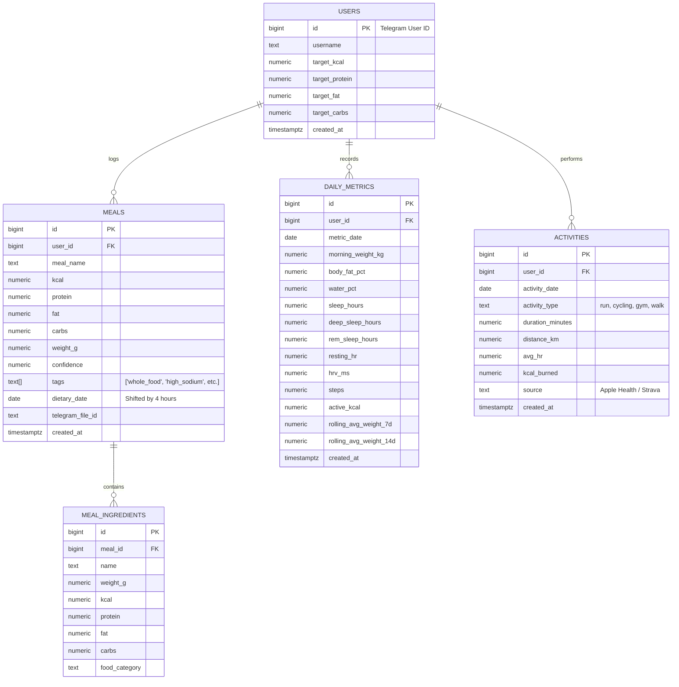

# Lifecore Database (Schema & Design)

Data is stored in a relational **PostgreSQL** database managed by **Supabase**.

---

## 1. Conceptual ERD Diagram



---

## 2. Table Specifications

### 2.1. `meals` Table
Stores each individual meal, recognized via Telegram bot or entered manually.

| Column | Type | Description |
| :--- | :--- | :--- |
| `id` | `BIGINT PRIMARY KEY` | Unique record identifier |
| `user_id` | `BIGINT NOT NULL` | User's Telegram Chat ID |
| `meal_name` | `TEXT NOT NULL` | Meal name |
| `kcal` | `NUMERIC NOT NULL` | Calories (including the +15% deficit buffer) |
| `protein` | `NUMERIC NOT NULL` | Protein (grams) |
| `fat` | `NUMERIC NOT NULL` | Fats (grams) |
| `carbs` | `NUMERIC NOT NULL` | Carbohydrates (grams) |
| `weight_g` | `NUMERIC NOT NULL` | Estimated cooked meal weight (grams) |
| `confidence` | `NUMERIC` | AI confidence percentage (0–100) |
| `tags` | `TEXT[]` | Quality tags array: `['whole_food', 'solid', 'high_sodium']` |
| `micronutrients` | `JSONB` | Micronutrient estimation (`fiber_g`, `sodium_mg`, `potassium_mg`, `vitamin_c_mg`, etc.) |
| `amino_acids` | `JSONB` | Amino acid profile (`bcaa_g`, `leucine_g`) for protein meals |
| `dietary_date` | `DATE NOT NULL` | Dietary date (4-hour shift, day changes at 04:00) |
| `telegram_file_id` | `TEXT` | Telegram photo ID for further analysis |
| `created_at` | `TIMESTAMPTZ` | Exact system recording time (UTC) |

---

### 2.2. `body_measurements` Table
Stores individual weight measurements via the `/w` command or smart scale with placeholders for electrical impedance.

| Column | Type | Description |
| :--- | :--- | :--- |
| `id` | `BIGINT PRIMARY KEY` | Unique measurement identifier |
| `user_id` | `BIGINT NOT NULL` | User's Telegram Chat ID |
| `weight_kg` | `NUMERIC NOT NULL` | Body weight (kg) |
| `dietary_date` | `DATE NOT NULL` | Dietary date of the measurement |
| `measured_at` | `TIMESTAMPTZ` | Exact measurement time (UTC) |
| `impedance_ohms` | `NUMERIC` | Tissue electrical impedance (Ohms) from smart scale |
| `impedance_frequency_khz` | `NUMERIC` | Scale current frequency (default 50 kHz) |
| `body_fat_pct` | `NUMERIC` | Body fat percentage (%) |
| `water_pct` | `NUMERIC` | Tissue hydration percentage (%) |
| `muscle_mass_kg` | `NUMERIC` | Muscle mass (kg) |
| `bone_mass_kg` | `NUMERIC` | Bone mass (kg) |
| `visceral_fat` | `NUMERIC` | Visceral fat level (1-50) |
| `source` | `TEXT` | Source of record: `telegram_w`, `bluetooth_scale`, `apple_health` |
| `created_at` | `TIMESTAMPTZ` | System entry time |

---

### 2.3. `daily_metrics` Table
Stores aggregated daily metrics for body, sleep, and overall activity.

| Column | Type | Description |
| :--- | :--- | :--- |
| `id` | `BIGINT PRIMARY KEY` | Unique identifier |
| `user_id` | `BIGINT NOT NULL` | User's Telegram Chat ID |
| `metric_date` | `DATE NOT NULL` | Calendar date of measurements |
| `morning_weight_kg` | `NUMERIC` | Morning weight on an empty stomach |
| `body_fat_pct` | `NUMERIC` | Body fat percentage (from smart scale) |
| `water_pct` | `NUMERIC` | Body water percentage |
| `sleep_hours` | `NUMERIC` | Total sleep duration (hours) |
| `deep_sleep_hours` | `NUMERIC` | Deep sleep phase (hours) |
| `rem_sleep_hours` | `NUMERIC` | REM sleep phase (hours) |
| `resting_hr` | `NUMERIC` | Resting Heart Rate (bpm) |
| `hrv_ms` | `NUMERIC` | Heart Rate Variability (HRV, milliseconds) |
| `steps` | `INTEGER` | Steps taken during the day |
| `active_kcal` | `NUMERIC` | Calories burned from activity (Active Burn) |
| `rolling_avg_weight_7d` | `NUMERIC` | 7-day rolling average weight |
| `rolling_avg_weight_14d` | `NUMERIC` | 14-day rolling average weight |

---

## 3. SQL Structure Creation Script (DDL)

```sql
-- Meals table
CREATE TABLE IF NOT EXISTS public.meals (
    id BIGINT GENERATED BY DEFAULT AS IDENTITY PRIMARY KEY,
    user_id BIGINT NOT NULL,
    meal_name TEXT NOT NULL,
    kcal NUMERIC NOT NULL,
    protein NUMERIC NOT NULL,
    fat NUMERIC NOT NULL,
    carbs NUMERIC NOT NULL,
    weight_g NUMERIC NOT NULL,
    confidence NUMERIC,
    tags TEXT[] DEFAULT '{}'::TEXT[],
    micronutrients JSONB DEFAULT '{}'::JSONB,
    amino_acids JSONB DEFAULT '{}'::JSONB,
    dietary_date DATE NOT NULL,
    telegram_file_id TEXT,
    created_at TIMESTAMPTZ DEFAULT timezone('utc'::text, now()) NOT NULL
);

CREATE INDEX IF NOT EXISTS idx_meals_user_date ON public.meals(user_id, dietary_date);
CREATE INDEX IF NOT EXISTS idx_meals_tags ON public.meals USING GIN (tags);
CREATE INDEX IF NOT EXISTS idx_meals_micronutrients ON public.meals USING GIN (micronutrients);
CREATE INDEX IF NOT EXISTS idx_meals_amino_acids ON public.meals USING GIN (amino_acids);

-- Body measurements table
CREATE TABLE IF NOT EXISTS public.body_measurements (
    id BIGINT GENERATED BY DEFAULT AS IDENTITY PRIMARY KEY,
    user_id BIGINT NOT NULL,
    weight_kg NUMERIC NOT NULL,
    dietary_date DATE NOT NULL,
    measured_at TIMESTAMPTZ DEFAULT timezone('utc'::text, now()) NOT NULL,
    impedance_ohms NUMERIC,
    impedance_frequency_khz NUMERIC DEFAULT 50,
    body_fat_pct NUMERIC,
    water_pct NUMERIC,
    muscle_mass_kg NUMERIC,
    bone_mass_kg NUMERIC,
    visceral_fat NUMERIC,
    source TEXT DEFAULT 'telegram_w',
    created_at TIMESTAMPTZ DEFAULT timezone('utc'::text, now()) NOT NULL
);

CREATE INDEX IF NOT EXISTS idx_body_measurements_user_date ON public.body_measurements(user_id, dietary_date);
CREATE INDEX IF NOT EXISTS idx_body_measurements_measured_at ON public.body_measurements(user_id, measured_at DESC);

-- Daily biometric metrics table
CREATE TABLE IF NOT EXISTS public.daily_metrics (
    id BIGINT GENERATED BY DEFAULT AS IDENTITY PRIMARY KEY,
    user_id BIGINT NOT NULL,
    metric_date DATE NOT NULL,
    morning_weight_kg NUMERIC,
    body_fat_pct NUMERIC,
    water_pct NUMERIC,
    sleep_hours NUMERIC,
    deep_sleep_hours NUMERIC,
    rem_sleep_hours NUMERIC,
    resting_hr NUMERIC,
    hrv_ms NUMERIC,
    steps INTEGER,
    active_kcal NUMERIC,
    rolling_avg_weight_7d NUMERIC,
    rolling_avg_weight_14d NUMERIC,
    created_at TIMESTAMPTZ DEFAULT timezone('utc'::text, now()) NOT NULL,
    UNIQUE(user_id, metric_date)
);

CREATE INDEX IF NOT EXISTS idx_daily_metrics_date ON public.daily_metrics(user_id, metric_date);
```
