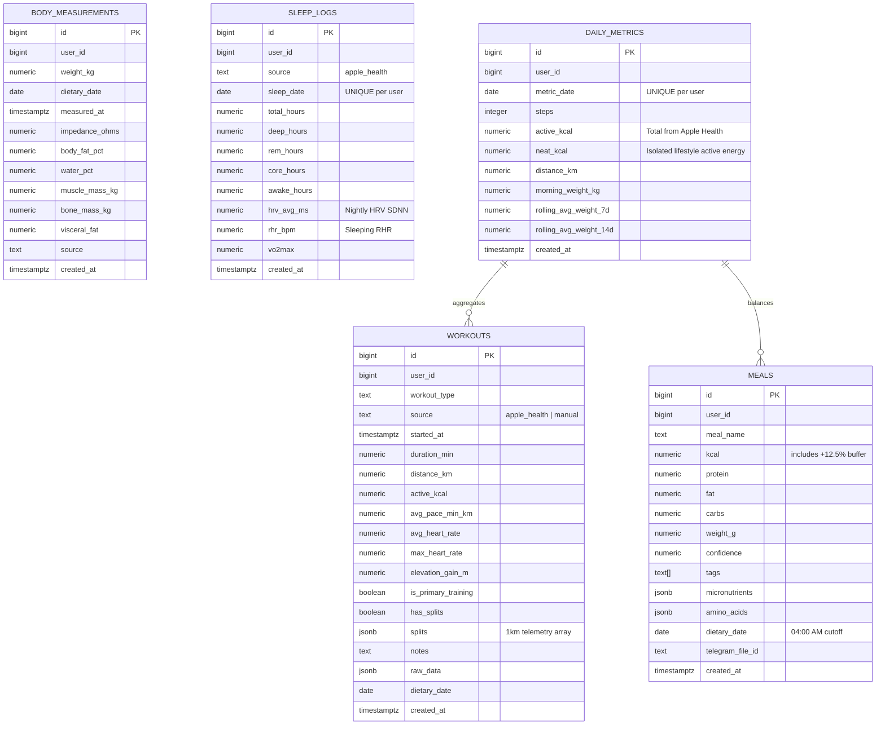

# Lifecore Database Schema & Data Dictionary

> **Target Database:** PostgreSQL 15+ (hosted on Supabase)  
> **Role in Lifecore 2.0:** Cloud Persistence, Synchronization, and Longitudinal Health Data Warehouse for the Native iOS Application.

---

## 1. Architectural Role in iOS-First Model

In **Lifecore 2.0**, local persistence is handled on-device via **SwiftData**, while **Supabase PostgreSQL** serves as the immutable cloud data warehouse and backup layer.

### Key Schema Decisions:
1. **JSONB Splits Caching vs Separate Relational Table:**
   - Rather than creating a separate relational table (`workout_splits`) that requires complex SQL joins, 1km splits are parsed directly on-device from HealthKit and persisted as a structured `JSONB` array in `workouts.splits`.
   - **Rationale:** 100% of queries that display workout splits load the entire workout session at once. Storing splits as JSONB maps 1-to-1 with Swift `Codable` structs, avoids relational foreign-key overhead, and provides single-query delivery to both SwiftUI charts and the Gemini AI prompt.
2. **Deterministic NEAT Storage:**
   - `daily_metrics.neat_kcal` explicitly stores the mathematically isolated lifestyle movement ($\text{NEAT} = \max(0, \text{active\_kcal} - \sum \text{workout\_kcal})$).
3. **4-Hour Day Shift (`dietary_date`):**
   - All domain tables utilize `dietary_date` computed with a 4-hour offset (04:00 AM cutoff) so post-midnight meals and recovery metrics align with the correct physiological cycle.

---

## 2. Entity-Relationship Diagram (ERD)



---

## 3. Data Dictionary & Table Definitions

### 3.1. `workouts` — Athletic Sessions & Split Telemetry
Stores discrete physical training sessions.

| Column | Type | Constraints | Description |
|---|---|---|---|
| `id` | `BIGSERIAL` | `PRIMARY KEY` | Unique workout identifier |
| `user_id` | `BIGINT` | `NOT NULL` | User identifier |
| `workout_type` | `TEXT` | `NOT NULL` | Activity type (`running`, `strength`, `cycling`, `walking`, etc.) |
| `source` | `TEXT` | `DEFAULT 'apple_health'` | Origin of session |
| `started_at` | `TIMESTAMPTZ` | `NOT NULL` | Session start timestamp |
| `duration_min` | `NUMERIC(5, 1)` | `NOT NULL` | Total active duration in minutes |
| `distance_km` | `NUMERIC(6, 2)` | | Total distance covered |
| `active_kcal` | `NUMERIC(6, 1)` | | Active energy expenditure in calories |
| `avg_pace_min_km` | `NUMERIC(5, 2)` | | Average pace in minutes per km |
| `avg_heart_rate` | `NUMERIC(4, 1)` | | Average heart rate in bpm |
| `max_heart_rate` | `NUMERIC(4, 1)` | | Peak heart rate recorded |
| `elevation_gain_m` | `NUMERIC(6, 1)` | | Cumulative elevation gain in meters |
| `is_primary_training` | `BOOLEAN` | `DEFAULT FALSE` | True for structured runs/workouts, false for incidental walks |
| `has_splits` | `BOOLEAN` | `DEFAULT FALSE` | Indicates presence of detailed split array |
| `splits` | `JSONB` | `DEFAULT '[]'` | Structured 1km split telemetry array (see structure below) |
| `raw_data` | `JSONB` | `DEFAULT '{}'` | Raw payload from HealthKit |
| `dietary_date` | `DATE` | `NOT NULL` | Attributed dietary date (04:00 AM shift) |
| `created_at` | `TIMESTAMPTZ` | `DEFAULT NOW()` | Record insertion timestamp |

#### `splits` JSONB Structure:
```json
[
  {
    "km": 1,
    "elapsed_s": 372.5,
    "pace_min_km": 6.21,
    "avg_hr": 142.5,
    "max_hr": 149.0,
    "elev_diff_m": 2.5,
    "cadence": 164.0
  },
  {
    "km": 2,
    "elapsed_s": 368.0,
    "pace_min_km": 6.13,
    "avg_hr": 147.0,
    "max_hr": 153.0,
    "elev_diff_m": 4.0,
    "cadence": 166.0
  }
]
```

---

### 3.2. `daily_metrics` — Day-Level Summary & Rolling Trends
Captures whole-day lifestyle movement and longitudinal trend metrics.

| Column | Type | Constraints | Description |
|---|---|---|---|
| `id` | `BIGSERIAL` | `PRIMARY KEY` | Unique metric identifier |
| `user_id` | `BIGINT` | `NOT NULL` | User identifier |
| `metric_date` | `DATE` | `NOT NULL, UNIQUE(user_id, metric_date)` | Calendar date |
| `steps` | `INTEGER` | | Total steps logged by Apple Watch |
| `active_kcal` | `NUMERIC(6, 1)` | | Total active energy reported by Apple Health |
| `neat_kcal` | `NUMERIC(6, 1)` | | Mathematically isolated non-workout activity energy |
| `distance_km` | `NUMERIC(5, 2)` | | Total walking/running distance |
| `morning_weight_kg` | `NUMERIC(5, 2)` | | Morning scale weigh-in |
| `rolling_avg_weight_7d` | `NUMERIC(5, 2)` | | 7-day rolling weight average (noise-filtered) |
| `rolling_avg_weight_14d` | `NUMERIC(5, 2)` | | 14-day rolling weight average |
| `created_at` | `TIMESTAMPTZ` | `DEFAULT NOW()` | Record insertion timestamp |

---

### 3.3. `sleep_logs` — Sleep Architecture & Autonomic Health
Captures sleep stages and morning recovery biomarkers.

| Column | Type | Constraints | Description |
|---|---|---|---|
| `id` | `BIGSERIAL` | `PRIMARY KEY` | Unique log identifier |
| `user_id` | `BIGINT` | `NOT NULL` | User identifier |
| `sleep_date` | `DATE` | `NOT NULL, UNIQUE(user_id, sleep_date)` | Date corresponding to the night of sleep |
| `total_hours` | `NUMERIC(4, 2)` | `NOT NULL` | Total time asleep |
| `deep_hours` | `NUMERIC(4, 2)` | | Deep sleep duration |
| `rem_hours` | `NUMERIC(4, 2)` | | REM sleep duration |
| `core_hours` | `NUMERIC(4, 2)` | | Core/Light sleep duration |
| `awake_hours` | `NUMERIC(4, 2)` | | Time awake during sleep session |
| `hrv_avg_ms` | `NUMERIC(5, 1)` | | Average morning HRV (SDNN) |
| `rhr_bpm` | `NUMERIC(4, 1)` | | Resting Heart Rate during sleep |
| `vo2max` | `NUMERIC(4, 1)` | | Cardiorespiratory fitness score |
| `created_at` | `TIMESTAMPTZ` | `DEFAULT NOW()` | Record insertion timestamp |

---

### 3.4. `meals` — Vision-Based Nutrition Logs
Stores individual meals recognized by Gemini Vision.

| Column | Type | Constraints | Description |
|---|---|---|---|
| `id` | `BIGSERIAL` | `PRIMARY KEY` | Unique meal identifier |
| `user_id` | `BIGINT` | `NOT NULL` | User identifier |
| `meal_name` | `TEXT` | `NOT NULL` | Descriptive name of dish |
| `kcal` | `NUMERIC(6, 1)` | `NOT NULL` | Calorie content (includes $\times 1.125$ deficit buffer) |
| `protein` | `NUMERIC(5, 1)` | `NOT NULL` | Protein in grams |
| `fat` | `NUMERIC(5, 1)` | `NOT NULL` | Fat in grams |
| `carbs` | `NUMERIC(5, 1)` | `NOT NULL` | Carbohydrates in grams |
| `weight_g` | `NUMERIC(6, 1)` | | Estimated plate weight in grams |
| `confidence` | `NUMERIC(3, 2)` | | AI recognition confidence score (0.00–1.00) |
| `tags` | `TEXT[]` | | Food quality tags (`whole_food`, `ultra_processed`, etc.) |
| `micronutrients` | `JSONB` | `DEFAULT '{}'` | Fiber, sodium, potassium, vitamin C, iron |
| `amino_acids` | `JSONB` | `DEFAULT '{}'` | BCAA, leucine estimates |
| `dietary_date` | `DATE` | `NOT NULL` | Attributed dietary date (04:00 AM shift) |
| `created_at` | `TIMESTAMPTZ` | `DEFAULT NOW()` | Record insertion timestamp |
