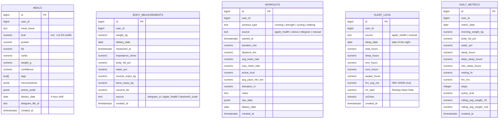

# Lifecore Database (Schema & Design)

Data is stored in a relational **PostgreSQL** database managed by **Supabase**.

---

## 1. ERD Diagram



---

## 2. Table Specifications

### 2.1. `meals` ✅ *Implemented*
Stores each meal logged via Telegram (photo or text).

| Column | Type | Description |
| :--- | :--- | :--- |
| `id` | `BIGINT PK` | Unique ID |
| `user_id` | `BIGINT NOT NULL` | Telegram Chat ID |
| `meal_name` | `TEXT NOT NULL` | Short name in Ukrainian |
| `kcal` | `NUMERIC NOT NULL` | Calories incl. +12.5% deficit buffer |
| `protein` | `NUMERIC NOT NULL` | Protein (g) — exact |
| `fat` | `NUMERIC NOT NULL` | Fat (g) — exact |
| `carbs` | `NUMERIC NOT NULL` | Carbs (g) — exact |
| `weight_g` | `NUMERIC NOT NULL` | Estimated cooked weight |
| `confidence` | `NUMERIC` | AI confidence 0–100 |
| `tags` | `TEXT[]` | `['whole_food', 'solid', 'high_sodium', ...]` |
| `micronutrients` | `JSONB` | `{fiber_g, sodium_mg, potassium_mg, vitamin_c_mg, iron_mg, calcium_mg}` |
| `amino_acids` | `JSONB` | `{bcaa_g, leucine_g}` |
| `dietary_date` | `DATE NOT NULL` | 4-hour shifted date |
| `telegram_file_id` | `TEXT` | Telegram file ID for re-analysis |
| `created_at` | `TIMESTAMPTZ` | Exact logging time (UTC) |

---

### 2.2. `body_measurements` ✅ *Implemented*
Weight measurements from `/w` command or smart scale.

| Column | Type | Description |
| :--- | :--- | :--- |
| `id` | `BIGINT PK` | |
| `user_id` | `BIGINT NOT NULL` | |
| `weight_kg` | `NUMERIC NOT NULL` | Body weight |
| `dietary_date` | `DATE NOT NULL` | |
| `measured_at` | `TIMESTAMPTZ` | |
| `impedance_ohms` | `NUMERIC` | BIA impedance |
| `impedance_frequency_khz` | `NUMERIC` | Default 50 kHz |
| `body_fat_pct` | `NUMERIC` | % body fat |
| `water_pct` | `NUMERIC` | % body water |
| `muscle_mass_kg` | `NUMERIC` | Muscle mass |
| `bone_mass_kg` | `NUMERIC` | Bone mass |
| `visceral_fat` | `NUMERIC` | Visceral fat level 1–50 |
| `source` | `TEXT` | `telegram_w` \| `bluetooth_scale` \| `apple_health` |

---

### 2.3. `workouts` ✅ *Implemented*
Physical activity: running, strength, cycling — from Telegram, Apple Health, or Strava.

| Column | Type | Description |
| :--- | :--- | :--- |
| `id` | `BIGINT PK` | |
| `user_id` | `BIGINT NOT NULL` | |
| `workout_type` | `TEXT NOT NULL` | `running` \| `strength` \| `cycling` \| `walking` \| `other` |
| `source` | `TEXT` | `apple_health` \| `strava` \| `telegram` \| `manual` |
| `started_at` | `TIMESTAMPTZ NOT NULL` | Workout start time |
| `duration_min` | `NUMERIC NOT NULL` | Duration (min) |
| `distance_km` | `NUMERIC` | Distance (cardio only) |
| `avg_heart_rate` | `NUMERIC` | Avg HR (bpm) |
| `max_heart_rate` | `NUMERIC` | Max HR (bpm) |
| `active_kcal` | `NUMERIC` | Calories burned |
| `avg_pace_min_km` | `NUMERIC` | Pace min/km (running/cycling) |
| `elevation_m` | `NUMERIC` | Elevation gain (m) |
| `notes` | `TEXT` | User note or AI summary |
| `raw_data` | `JSONB` | Original payload from Strava/Health |
| `dietary_date` | `DATE NOT NULL` | 4-hour shifted date |

---

### 2.4. `sleep_logs` ✅ *Implemented*
Nightly sleep phases + recovery biomarkers from Apple Watch.

| Column | Type | Description |
| :--- | :--- | :--- |
| `id` | `BIGINT PK` | |
| `user_id` | `BIGINT NOT NULL` | |
| `source` | `TEXT` | `apple_health` \| `manual` |
| `sleep_date` | `DATE NOT NULL` | Date of the night (evening date) |
| `total_hours` | `NUMERIC` | Total sleep time |
| `deep_hours` | `NUMERIC` | Deep sleep phase |
| `rem_hours` | `NUMERIC` | REM phase |
| `core_hours` | `NUMERIC` | Core/light sleep |
| `awake_hours` | `NUMERIC` | Time awake in bed |
| `hrv_avg_ms` | `NUMERIC` | HRV SDNN averaged overnight (ms) |
| `rhr_bpm` | `NUMERIC` | Resting Heart Rate at wake-up |
| `vo2max` | `NUMERIC` | VO2Max estimate if updated |

**Constraint:** `UNIQUE (user_id, sleep_date)` — one record per night per user.

---

### 2.5. `daily_metrics` 📅 *Phase 3*
Aggregated daily dashboard view (filled by PostgreSQL trigger or Edge Function).

| Column | Type | Description |
| :--- | :--- | :--- |
| `morning_weight_kg` | `NUMERIC` | From `body_measurements` |
| `sleep_hours` | `NUMERIC` | From `sleep_logs` |
| `resting_hr` | `NUMERIC` | From `sleep_logs.rhr_bpm` |
| `hrv_ms` | `NUMERIC` | From `sleep_logs.hrv_avg_ms` |
| `steps` | `INTEGER` | From iOS Shortcut or Apple Health |
| `active_kcal` | `NUMERIC` | From `workouts` |
| `rolling_avg_weight_7d` | `NUMERIC` | Computed: 7-day rolling avg |
| `rolling_avg_weight_14d` | `NUMERIC` | Computed: 14-day rolling avg |

---

## 3. SQL DDL

### Migration 001 — Initial (✅ Applied)
See: [`supabase/migrations/001_initial.sql`](../supabase/migrations/001_initial.sql)

### Migration 002 — Workouts (🔜 Pending)
See: [`supabase/migrations/002_workouts.sql`](../supabase/migrations/002_workouts.sql)

```sql
-- Quick apply in Supabase SQL Editor:
\i supabase/migrations/002_workouts.sql
```

### Migration 003 — Sleep Logs (🔜 Pending)
See: [`supabase/migrations/003_sleep_logs.sql`](../supabase/migrations/003_sleep_logs.sql)

```sql
\i supabase/migrations/003_sleep_logs.sql
```

---

## 4. Key Indexes

```sql
-- meals: fast daily aggregation
CREATE INDEX idx_meals_user_date ON meals(user_id, dietary_date);
CREATE INDEX idx_meals_tags ON meals USING GIN (tags);

-- body_measurements: latest weight query
CREATE INDEX idx_body_measurements_measured_at ON body_measurements(user_id, measured_at DESC);

-- workouts: coach context query (last 3 days)
CREATE INDEX idx_workouts_user_date ON workouts(user_id, dietary_date);
CREATE INDEX idx_workouts_started_at ON workouts(user_id, started_at DESC);

-- sleep_logs: coach context query
CREATE INDEX idx_sleep_logs_user_date ON sleep_logs(user_id, sleep_date DESC);
```

---

## 5. Coach Context Query

The `/coach` command uses this query to gather 3-day context for Gemini:

```sql
-- Meals (last 3 dietary days)
SELECT dietary_date,
       SUM(kcal) AS total_kcal,
       SUM(protein) AS protein_g,
       SUM(carbs) AS carbs_g,
       SUM(fat) AS fat_g,
       array_agg(DISTINCT unnest(tags)) AS all_tags
FROM meals
WHERE user_id = $1 AND dietary_date >= CURRENT_DATE - 3
GROUP BY dietary_date ORDER BY dietary_date;

-- Sleep (last 3 nights)
SELECT sleep_date, total_hours, deep_hours, rem_hours, hrv_avg_ms, rhr_bpm
FROM sleep_logs
WHERE user_id = $1 AND sleep_date >= CURRENT_DATE - 4
ORDER BY sleep_date;

-- Workouts (last 3 days)
SELECT dietary_date, workout_type, duration_min, avg_heart_rate, active_kcal, distance_km, avg_pace_min_km
FROM workouts
WHERE user_id = $1 AND dietary_date >= CURRENT_DATE - 3
ORDER BY started_at;
```
