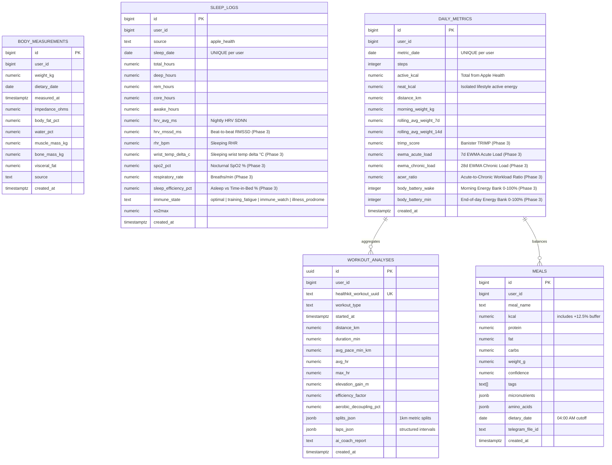

# Lifecore Database Schema & Data Dictionary

> **Target Database:** PostgreSQL 15+ (hosted on Supabase)
> **Role in Lifecore 3.2:** Cloud Persistence, Synchronization, and Longitudinal Health Data Warehouse for the Native iOS Application.

---

### 1. Architectural Role in iOS-First Model

In **Lifecore 3.2**, local persistence is handled on-device via **SwiftData**, while **Supabase PostgreSQL** serves as the immutable cloud data warehouse and backup layer. HealthKit is the primary canonical source of truth.

### Key Schema Decisions:

1. **`workout_analyses` with JSONB Splits & Laps vs Separate Relational Tables:**
   - Rather than creating multiple relational tables (`workout_splits`, `workout_laps`) with complex foreign-key joins, `workout_analyses` stores:
     - `splits_json`: 1,000m incremental auto-splits (pace, average HR, elevation delta, cadence).
     - `laps_json`: manual/structured interval laps (work pace, rest HR recovery).
     - Deterministic metrics: `efficiency_factor`, `aerobic_decoupling_pct`.
     - `ai_coach_report`: generated qualitative 70/15/15 performance narrative.
   - **Rationale:** 100% of queries that display workout analysis load the entire session. Storing splits and laps as JSONB maps 1-to-1 with Swift `Codable` structs, avoids relational join overhead, and provides instant single-query delivery to both SwiftUI charts and the Gemini AI prompt.
2. **Deterministic NEAT Storage:**
   - `daily_metrics.neat_kcal` explicitly stores the mathematically isolated lifestyle movement ($\text{NEAT} = \max(0, \text{active\_kcal} - \sum \text{workout\_kcal})$).
3. **4-Hour Day Shift (`dietary_date`):**
   - Nutrition and metric tables utilize `dietary_date` computed with a 4-hour offset (04:00 AM cutoff) so post-midnight meals and recovery metrics align with the correct physiological cycle.

---

## 2. Entity-Relationship Diagram (ERD)



---

## 3. Data Dictionary & Table Definitions

### 3.1. `workout_analyses` — Athletic Sessions & Split Telemetry

Stores discrete athletic sessions with pre-calculated telemetry and AI performance reports.

| Column                   | Type              | Constraints                           | Description                                                            |
| ------------------------ | ----------------- | ------------------------------------- | ---------------------------------------------------------------------- |
| `id`                     | `UUID`            | `PRIMARY KEY, DEFAULT gen_random_uuid()` | Unique record identifier                                            |
| `user_id`                | `BIGINT`          | `NOT NULL`                            | User identifier                                                        |
| `healthkit_workout_uuid` | `TEXT`            | `UNIQUE, NOT NULL`                    | Unique identifier from Apple HealthKit (`HKWorkout.uuid`)              |
| `workout_type`           | `TEXT`            | `NOT NULL`                            | Activity type (`running`, `strength`, `cycling`, etc.)                 |
| `started_at`             | `TIMESTAMPTZ`     | `NOT NULL`                            | Session start timestamp                                                |
| `distance_km`            | `NUMERIC(6, 2)`   |                                       | Total distance in kilometers                                           |
| `duration_min`           | `NUMERIC(6, 2)`   |                                       | Total duration in minutes                                              |
| `avg_pace_min_km`        | `NUMERIC(5, 2)`   |                                       | Average pace in minutes per km                                         |
| `avg_hr`                 | `NUMERIC(5, 1)`   |                                       | Average heart rate in bpm                                              |
| `max_hr`                 | `NUMERIC(5, 1)`   |                                       | Maximum heart rate in bpm                                              |
| `elevation_gain_m`       | `NUMERIC(6, 1)`   |                                       | Total elevation gain in meters                                         |
| `efficiency_factor`      | `NUMERIC(5, 3)`   |                                       | Speed (m/min) / Average HR (bpm)                                       |
| `aerobic_decoupling_pct` | `NUMERIC(5, 2)`   |                                       | Decoupling % between first and second half                             |
| `splits_json`            | `JSONB`           | `NOT NULL`                            | Structured 1km split telemetry array                                   |
| `laps_json`              | `JSONB`           |                                       | Structured interval laps array from `HKWorkoutActivity`                |
| `ai_coach_report`        | `TEXT`            |                                       | Generated 70/15/15 AI performance analyst narrative                    |
| `created_at`             | `TIMESTAMPTZ`     | `DEFAULT NOW()`                       | Record insertion timestamp                                             |

#### `splits_json` Structure:

```json
[
  {
    "km": 1,
    "duration_s": 372.5,
    "pace_min_km": 6.21,
    "avg_hr": 142.5,
    "max_hr": 149.0,
    "elevation_diff_m": 2.5,
    "avg_cadence": 164.0
  },
  {
    "km": 2,
    "duration_s": 368.0,
    "pace_min_km": 6.13,
    "avg_hr": 147.0,
    "max_hr": 153.0,
    "elevation_diff_m": 4.0,
    "avg_cadence": 166.0
  }
]
```

#### `laps_json` Structure:

```json
[
  {
    "lap_index": 1,
    "type": "work",
    "duration_s": 180.0,
    "distance_m": 800.0,
    "avg_pace_min_km": 3.75,
    "avg_hr": 168.0,
    "max_hr": 174.0
  },
  {
    "lap_index": 2,
    "type": "recovery",
    "duration_s": 90.0,
    "distance_m": 120.0,
    "hr_drop_bpm": 28.0
  }
```

---

### 3.2. `daily_metrics` — Day-Level Summary & Rolling Trends

Captures whole-day lifestyle movement and longitudinal trend metrics.

| Column                     | Type              | Constraints                                | Description                                         |
| -------------------------- | ----------------- | ------------------------------------------ | --------------------------------------------------- |
| `id`                     | `BIGSERIAL`     | `PRIMARY KEY`                            | Unique metric identifier                            |
| `user_id`                | `BIGINT`        | `NOT NULL`                               | User identifier                                     |
| `metric_date`            | `DATE`          | `NOT NULL, UNIQUE(user_id, metric_date)` | Calendar date                                       |
| `steps`                  | `INTEGER`       |                                            | Total steps logged by Apple Watch                   |
| `active_kcal`            | `NUMERIC(6, 1)` |                                            | Total active energy reported by Apple Health        |
| `neat_kcal`              | `NUMERIC(6, 1)` |                                            | Mathematically isolated non-workout activity energy |
| `distance_km`            | `NUMERIC(5, 2)` |                                            | Total walking/running distance                      |
| `morning_weight_kg`      | `NUMERIC(5, 2)` |                                            | Morning scale weigh-in                              |
| `rolling_avg_weight_7d`  | `NUMERIC(5, 2)` |                                            | 7-day rolling weight average (noise-filtered)       |
| `rolling_avg_weight_14d` | `NUMERIC(5, 2)` |                                            | 14-day rolling weight average                       |
| `trimp_score`            | `NUMERIC(6, 1)` |                                            | Banister's Training Impulse internal load (Phase 3) |
| `ewma_acute_load`        | `NUMERIC(6, 1)` |                                            | 7-day EWMA Acute Load ($\lambda_a = 2/8$, Phase 3)  |
| `ewma_chronic_load`      | `NUMERIC(6, 1)` |                                            | 28-day EWMA Chronic Load ($\lambda_c = 2/29$, Phase 3) |
| `acwr_ratio`             | `NUMERIC(4, 2)` |                                            | Acute-to-Chronic Workload Ratio ($0.80\text{--}1.30$ sweet spot) |
| `body_battery_wake`      | `INTEGER`       |                                            | Morning Energy Bank starting reserve (0–100%)       |
| `body_battery_min`       | `INTEGER`       |                                            | End-of-day Energy Bank reserve (0–100%)             |
| `created_at`             | `TIMESTAMPTZ`   | `DEFAULT NOW()`                          | Record insertion timestamp                          |

---

### 3.3. `sleep_logs` — Sleep Architecture, 5-Metric Overnight Vitals & Immune State

Captures sleep stages, nocturnal recovery biomarkers, and NightSignal + Apple Vitals confluence state.

| Column                 | Type              | Constraints                               | Description                                                       |
| ---------------------- | ----------------- | ----------------------------------------- | ----------------------------------------------------------------- |
| `id`                   | `BIGSERIAL`       | `PRIMARY KEY`                             | Unique log identifier                                             |
| `user_id`              | `BIGINT`          | `NOT NULL`                                | User identifier                                                   |
| `sleep_date`           | `DATE`            | `NOT NULL, UNIQUE(user_id, sleep_date)`   | Date corresponding to the night of sleep                          |
| `total_hours`          | `NUMERIC(4, 2)`   | `NOT NULL`                                | Total time asleep                                                 |
| `deep_hours`           | `NUMERIC(4, 2)`   |                                           | Deep sleep duration                                               |
| `rem_hours`            | `NUMERIC(4, 2)`   |                                           | REM sleep duration                                                |
| `core_hours`           | `NUMERIC(4, 2)`   |                                           | Core/Light sleep duration                                         |
| `awake_hours`          | `NUMERIC(4, 2)`   |                                           | Time awake during sleep session                                   |
| `hrv_avg_ms`           | `NUMERIC(5, 1)`   |                                           | Average morning HRV (SDNN)                                        |
| `hrv_rmssd_ms`         | `NUMERIC(5, 1)`   |                                           | Beat-to-beat vagal HRV RMSSD filtered for artifacts (Phase 3)     |
| `rhr_bpm`              | `NUMERIC(4, 1)`   |                                           | Resting Heart Rate during sleep                                   |
| `wrist_temp_delta_c`   | `NUMERIC(4, 2)`   |                                           | Sleeping wrist temperature delta ($\Delta T^\circ\text{C}$) vs baseline |
| `spo2_pct`             | `NUMERIC(4, 1)`   |                                           | Overnight blood oxygen saturation ($\text{SpO}_2\%$)              |
| `respiratory_rate`     | `NUMERIC(4, 1)`   |                                           | Sleeping respiratory rate (breaths/min)                           |
| `sleep_efficiency_pct` | `NUMERIC(4, 1)`   |                                           | Asleep duration divided by total time in bed (%)                  |
| `immune_state`         | `TEXT`            | `DEFAULT 'optimal'`                       | `optimal`, `training_fatigue`, `immune_watch`, `illness_prodrome` |
| `vo2max`               | `NUMERIC(4, 1)`   |                                           | Cardiorespiratory fitness score                                   |
| `created_at`           | `TIMESTAMPTZ`     | `DEFAULT NOW()`                           | Record insertion timestamp                                        |

---

### 3.4. `meals` — Vision-Based Nutrition Logs

Stores individual meals recognized by Gemini Vision.

| Column             | Type              | Constraints       | Description                                                   |
| ------------------ | ----------------- | ----------------- | ------------------------------------------------------------- |
| `id`             | `BIGSERIAL`     | `PRIMARY KEY`   | Unique meal identifier                                        |
| `user_id`        | `BIGINT`        | `NOT NULL`      | User identifier                                               |
| `meal_name`      | `TEXT`          | `NOT NULL`      | Descriptive name of dish                                      |
| `kcal`           | `NUMERIC(6, 1)` | `NOT NULL`      | Calorie content (includes $\times 1.125$ deficit buffer)    |
| `protein`        | `NUMERIC(5, 1)` | `NOT NULL`      | Protein in grams                                              |
| `fat`            | `NUMERIC(5, 1)` | `NOT NULL`      | Fat in grams                                                  |
| `carbs`          | `NUMERIC(5, 1)` | `NOT NULL`      | Carbohydrates in grams                                        |
| `weight_g`       | `NUMERIC(6, 1)` |                   | Estimated plate weight in grams                               |
| `confidence`     | `NUMERIC(3, 2)` |                   | AI recognition confidence score (0.00–1.00)                  |
| `tags`           | `TEXT[]`        |                   | Food quality tags (`whole_food`, `ultra_processed`, etc.) |
| `micronutrients` | `JSONB`         | `DEFAULT '{}'`  | Fiber, sodium, potassium, vitamin C, iron                     |
| `amino_acids`    | `JSONB`         | `DEFAULT '{}'`  | BCAA, leucine estimates                                       |
| `dietary_date`   | `DATE`          | `NOT NULL`      | Attributed dietary date (04:00 AM shift)                      |
| `created_at`     | `TIMESTAMPTZ`   | `DEFAULT NOW()` | Record insertion timestamp                                    |

---

## 4. SwiftData Local-First Storage Architecture (`SwiftDataModels.swift` & `TrainingPlanModels.swift`)

In addition to PostgreSQL cloud synchronization, the native iOS application maintains local-first SwiftData `@Model` entities:

| Model Entity | Storage File | Scope & Attributes |
|---|---|---|
| `MealEntity` | `SwiftDataModels.swift` | Tracks optimistic meal insertions, micronutrients, amino acids, +12.5% deficit buffer, and `syncedToCloud` flag. |
| `WorkoutAnalysisEntity` | `SwiftDataModels.swift` | Caches 1km auto-splits JSON, interval laps JSON, EF, cardiac drift %, and Gemini AI coach narrative. |
| `AthleteTrainingPlanState` | `TrainingPlanModels.swift` | Persists the rolling stimulus queue index (`currentQueueIndex`), weekly run frequency, session duration cap, target ACWR ratio, and club run override toggle. |

