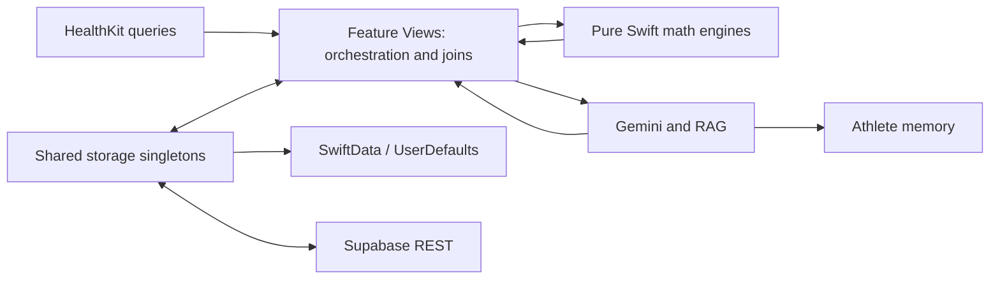

# Lifecore architecture and product audit

Date: 2026-11-12. Baseline: `3e6b998` on `main`. Scope: native app, checked-in SQL, prompts, historical design plans, build and test configuration. This is an audit and redesign proposal; no application code or database has been changed.

## Executive assessment

The product idea is coherent: combine Apple Watch telemetry, workout analysis and meal logging into one useful daily athletic decision, with deterministic Swift metrics and Ukrainian AI explanation. Native SwiftUI, HealthKit, local persistence and separate math engines are appropriate foundations. Preserve those investments.

The current implementation overstates its reliability. Production paths manufacture missing observations, separate screens assemble incompatible physiological inputs, AI failures look like successful analysis, and cloud restore does not match the upload schema. A cosmetic reskin would preserve these defects. The recommended redesign starts with truthful data states and a shared daily snapshot, then replaces the dense cockpit with a calm native hierarchy.

The user's selected direction is **calm native iOS, clear hierarchy, minimal visual noise**. This is approval of the direction, not a claim that every proposed screen has been reviewed.

## Method and limits

- Three independent read-only reviews covered UI/state, HealthKit/math, and storage/AI; findings were reconciled with source inspection.
- Source anchors below refer to baseline `3e6b998`. `APP/` means `ios/Lifecore/Lifecore/Lifecore/`.
- **Reproduced** means an isolated Swift probe or actual build/test command ran. **Code-confirmed** means a concrete reachable control/data-flow defect; it is not a claim of observed production harm.
- Visual crowding/accessibility observations are source-level risks. No simulator screenshots, VoiceOver session, physical-device HealthKit permission test or user usability study was performed.
- No production database was queried or modified. Deployed policies, migration history, actual leaked data, provider availability and real-device performance remain unverified.
- This audit assesses software against project rules; it does not validate clinical efficacy of readiness, illness, battery or training models. Existing clinical-grade/performance claims are unsupported by evidence in this review.

## Actual architecture

Four feature tabs exist and math has useful standalone units. However, dependency composition is mostly `.shared`; Today and Trends build their own histories; Workouts constructs a separate prescription; missingness/provenance is not a first-class contract. SwiftData save failures are frequently swallowed. This differs materially from the clean layered diagram in older architecture documents.

At baseline, 38 feature/core Swift files contain 16,914 lines (excluding App/Intents). Large orchestration files include HealthKitManager (1,169), GeminiService (920), TodayView (856) and TrendsComponents (889). Size itself is not a defect; mixed responsibilities and independent state construction are the relevant problems.

## Findings register

Priority: **P1** must be addressed before treating redesigned outputs as trustworthy; **P2** should be addressed within the redesign. No P0/live incident is asserted. Task IDs map to the execution plans.

### F01 — Synthetic health data enters the real dashboard and sync [P1, code-confirmed; R2]

Evidence: `APP/Features/Today/TodayView.swift:577–582,683–759,763–774`; `APP/Core/HealthKit/HealthKitManager.swift:731,770–774,845–850,909–913`.

Trigger: unavailable/failed HealthKit or sparse histories. Today creates 9,240 steps, 865 active kcal and a 7.8h night; history readers can produce synthetic weight/autonomic/efficiency histories. No provenance prevents these values feeding analytics or manual cloud sync. Replace with explicit absent/stale/error states; fixtures must be isolated from user stores and network writes. Regression: empty and failing providers produce no measured values or telemetry upload.

### F02 — Daily load and battery do not use real longitudinal/event timing [P1, reproduced + code-confirmed; R3]

Evidence: `APP/Core/HealthKit/HealthKitManager.swift:665–684`. ACWR receives one sample with a minimum load of 25; every workout is assigned hour 17. Isolated calls with loads 25, 100 and 500 all returned ratio 1.0 / sweetSpot. Workout timing is ignored. Supply dated history including known rest days, preserve unknown days, and use actual start/end times. Regression: a load spike changes ratio; 07:00 and 19:00 sessions affect different battery intervals.

### F03 — Tabs disagree about today's prescription [P1, code-confirmed; R4]

Evidence: `APP/Features/Workouts/RollingHorizonDeckView.swift:15–24` hardcodes acute 64, chronic 60 and `.optimal`; `APP/Features/Today/TodayView.swift:589–606` uses another snapshot plus defaults. A degraded-vitals day can display incompatible training directives. One coordinator must publish one versioned prescription consumed by both tabs.

### F04 — Mixed-time/missing Vitals become normal observations [P1, code-confirmed; R3]

Evidence: `APP/Core/HealthKit/HealthKitManager.swift:649–654,1095`; latest-value reads have no time predicate and missing values use profile baselines. Independently old samples can masquerade as one current night. Bind observations to a documented sleep window, expose coverage and timestamps, and never count a substituted baseline as measured. Preserve the project confluence rules without inventing new diagnostic claims.

### F05 — Feature-level histories fabricate covariates [P1, code-confirmed; R2/R3]

Evidence: `APP/Features/Today/TodayView.swift:562–563,643–674`; corresponding join in `APP/Features/Trends/TrendsView.swift:190–249`. Fixed NEAT/workout energy, sleep stages and TRIMP enter adaptive math; unlogged meals become numerical zeros/quality ratios. Move joins into one provenance-aware builder. Distinguish no meal logs from a confirmed zero intake. Test that incomplete days cannot train sensitivities or justify dietary conclusions.

### F06 — AI outages produce plausible fabricated results [P1, code-confirmed; R5]

Evidence: `APP/Core/AI/GeminiService.swift:231–233,594–628,845–908`. Generic food fallback assigns fixed macros and confidence 88; chat fallback contains fixed physiological claims. Callers receive successful result types. Make failure explicit with retry/manual entry; offline narrative may only format supplied measured facts and must identify its origin.

### F07 — Nutrition buffer is delegated to the model [P1, code-confirmed; R5]

Evidence: `APP/Core/AI/FoodPrompt.swift:229`; `APP/Core/AI/GeminiService.swift:303–305`; `APP/Core/Storage/MealStorageService.swift:163–170,199–205`. The live path accepts model kcal unchanged; only fallback demonstrably applies native `round(exact * 1.125)`. Separate raw estimates from normalized stored values; apply exactly once in Swift, preserve macros, version legacy buffered records to avoid double multiplication.

### F08 — Malformed AI nutrition can silently succeed or trap [P1, reproduced; R5]

Evidence: `APP/Core/AI/FoodPrompt.swift:103–155`; `APP/Core/AI/GeminiService.swift:303–304`. An isolated decoder probe accepted `{}` as zero nutrition, negative macros, and `"kcal":"nan"` as NaN. The following `Int(meal.kcal)` is unsafe for non-finite values. Validate required fields, finite/nonnegative quantities and bounded confidence before formatting, persistence or HealthKit writes. Reject invalid responses as recoverable errors.

### F09 — Workout cloud restore uses the wrong schema [P1, code-confirmed; R7]

Evidence: `APP/Core/Storage/SupabaseSyncService.swift:106–110,333–355`; `supabase/migrations/006_workout_analyses.sql:10–24`. Upload/schema use `healthkit_workout_uuid`, `duration_min`, `distance_km`, `avg_hr`, `splits_json`; pull expects different keys including `workout_uuid`, so its guard skips legitimate rows. Use one typed DTO with explicit units for encode/decode; round-trip an actual schema-shaped fixture.

### F10 — Meal retries/deletes/undo are not a convergent sync protocol [P1, code-confirmed; R6/R7]

Evidence: `APP/Core/Storage/SupabaseSyncService.swift:30–65`; `APP/Core/Storage/MealStorageService.swift:223–251`. POST has no stable client UUID/conflict key, deletion has no cloud operation, restore reconstructs an entity without preserved sync state. An acknowledged remote insert followed by a lost response can duplicate on retry; deleted records remain remote. Persist an outbox, stable identity and tombstones, then test timeout-after-commit, relaunch and undo ordering.

### F11 — Persistence errors can look like successful saves [P1, code-confirmed; R6]

Evidence: `APP/Core/Storage/SwiftDataModels.swift:229–235`; `APP/Core/Storage/MealStorageService.swift:108–121,145–149,178–184,215–219`. Store creation silently falls back to volatile memory; legacy backup is removed after `try? save()`. A disk/migration error can lose new entries or the only legacy copy. Surface recovery state, preserve original bytes, and acknowledge a save only after durable success.

### F12 — Cloud identity and AI credential configuration need a release gate [P1, configuration-confirmed; R8]

Evidence: `APP/Core/Storage/SupabaseSyncService.swift:8–10,61–62`; `APP/Core/AI/GeminiService.swift:151–179`; checked-in migrations lack RLS policies. Client uses a hardcoded shared identity and a reversibly bundled AI credential, with no demonstrated authenticated session. Do not treat a public Supabase publishable key as a secret. Deployed RLS is unknown: no claim of actual public data access. Inventory deployed policies read-only during execution, isolate identities, remove the bundled AI credential and rotate it through its owner, validate denial tests before wider distribution.

### F13 — First kilometer can omit elapsed time before first distance sample [P1, reproduced; R3]

Evidence: `APP/Core/HealthKit/WorkoutTelemetryExtractor.swift:135–158`; `APP/Core/MathEngine/WorkoutMathEngine.swift:214`. The first cumulative-distance point is timestamped after activity begins; splitting starts its clock there. Fixture with first 100m at 36s returned a 324s first kilometer instead of 360s. Anchor at workout start with zero distance and explicitly handle pauses, coarse samples and partial final kilometers.

### F14 — Flat outdoor running becomes treadmill running [P2, reproduced; R3]

Evidence: `APP/Core/MathEngine/WorkoutMathEngine.swift:559`. Zero elevation overrides explicit outdoor metadata for runs over 1km. Probe with `isIndoor=false` returned `isIndoorTreadmill=true`. Indoor/outdoor must come from metadata or unknown state, never missing elevation.

### F15 — Correlation narrative contradicts its measured sign [P1, reproduced; R3]

Evidence: `APP/Core/MathEngine/CorrelationEngine.swift:290–299`. Probe with r=-1 still described a positive deep-sleep effect of 15–25 minutes. The magnitude is canned, not derived from the paired data. Render sign, sample count, date range and uncertainty; omit unsupported effect sizes and causal claims.

### F16 — Weight chart can construct an invalid closed range [P1, code-confirmed; U5]

Evidence: `APP/Features/Trends/TrendsComponents.swift:290–291,340`. A single 38kg observation produces `40...39.5`; 152kg produces `150.5...150`. Swift ClosedRange requires ordered bounds. Compute a finite padded domain from valid observations without a population-specific clamp. Test empty/constant/38/152/non-finite series.

### F17 — Trend range selection can display stale results and shorter histories [P2, code-confirmed; U5]

Evidence: `APP/Features/Trends/TrendsView.swift:166–177,190`. `isLoading` early return drops the replacement request after `.task(id:)` cancellation; old results can publish under the new selector. Join generation caps at 30 days despite 60/90 choices. Use cancellation plus a request identity; every displayed analysis must declare its actual range and coverage.

### F18 — Hidden workout filter causes an unexplained empty category [P2, code-confirmed; U3]

Evidence: `APP/Features/Workouts/WorkoutsView.swift:64–69,84–85`. Enable hide-walks in All, then select Walks: filtering remains active while its control disappears. Reset the exclusion or scope it to All; preserve a clear reset action in empty results.

### F19 — Accessibility and navigation quality are not release-gated [P2, source-level risk; U1–U6]

Evidence: `APP/App/LifecoreApp.swift:18` forces light mode; fixed 10–11pt category text in `APP/Features/Trends/TrendsView.swift:125–143`; duplicate `btn_add_meal` identifiers in `APP/Features/Nutrition/NutritionView.swift:80,178`. Dense rows and custom gestures need large-text/VoiceOver evaluation. Exact clipping/contrast failures have not been visually measured. Use system text styles, adaptive layout, semantic actions and unique identifiers.

### F20 — Test and platform claims exceed current enforcement [P1, command-confirmed; R1/D1]

Evidence: `APP/App/LifecoreApp.swift:6–11` only prints verification failures; Xcode project has one application target and no test target; project settings specify iOS 27.0 and Swift 5.0, while docs advertise iOS17+/Xcode16+/Swift 6. Maestro flows mostly assert visibility (flow02 does not test delete/undo, flow01 does not reopen persisted weight). `scripts/run_e2e.sh:137–149` exits zero if Maestro is missing. CI selects Xcode16/fallback without an SDK compatibility assertion. Establish executable correctness tests, deterministic E2E fixtures and fail-on-missing-tool behavior.

### F21 — RAG nutrition windows are mislabeled [P1, code-confirmed; R5b]

Evidence: `APP/Core/Storage/MealStorageService.swift:51–55,262–264`; `APP/Core/AI/LifecoreContextRAG.swift:249–280`; `APP/Features/Today/TodayView.swift:33,51`. `fetchTodayMeals()` returns all meals, while the RAG sums its input into `last24h` fields. Workout inputs cover −36h/+1h yet receive the same label. Pass an explicit anchor/window, exclude pending/future entries, and retain coverage. Test −37h/−25h/−23h/+30m entries with a fixed clock.

### F22 — Sync and Siri can report success after failures [P1, code-confirmed; R7/R9]

Evidence: `APP/Core/Storage/SupabaseSyncService.swift:233–236,388–391`; `APP/Intents/LifecoreSyncIntent.swift:35–56`; `APP/Intents/LogMealIntent.swift:37,48–64`. HTTP errors are logged without thrown failure; sync failures become zero counts; food Intent failure still says saved and leaves a pending entry. Propagate structured partial/failure states and persist retry jobs before returning from an Intent.

### F23 — Initial cloud hydration is incomplete and lossy [P2, code-confirmed; R7]

Evidence: `APP/Core/Storage/SupabaseSyncService.swift:244–264,296–308,318`. Pull only occurs for empty local collections, caps meals at 60 and analyses at 30, omits meal confidence/micronutrients/amino acids and loses stable local identity. This is partial initial hydration, not general bidirectional convergence. Test paginated restore and remote updates when local records already exist.

### F24 — Local/cloud schema contracts and fresh migration order disagree [P2, code-confirmed; R7]

Evidence: `APP/Core/AI/FoodPrompt.swift:60`; `APP/Core/Storage/SupabaseSyncService.swift:43`; `supabase/migrations/001_initial.sql:16–17`; `docs/DATABASE.md` meal dictionary. Unknown weight is valid locally but NOT NULL in SQL. SQL confidence convention is 0–100 while documentation says 0–1. Use nullable weight and an explicit normalized confidence contract; never invent a weight to satisfy persistence. Additional source-confirmed mismatches: `SupabaseSyncService.swift:174–177` sends `neat_kcal`, absent from every checked-in migration; numbered005/007 alter `daily_metrics` before its only CREATE in `20260904160000_lifecore_schema.sql`. Fresh replay has an ordering prerequisite. Deployed schema/history were not inspected; R7 must verify bootstrap/replay and reconcile these contracts before deployment.

### F25 — Seed cleanup uses names as data identity [P2, code-confirmed; R6]

Evidence: `APP/Core/Storage/MealStorageService.swift:25–37`. Real meals matching demo names are deleted, including associated HealthKit data. Cleanup must require explicit seed provenance/known fixture IDs; ambiguous legacy rows remain untouched. Test equal names with different provenance.

### F26 — Calendar and physiological elapsed time are inconsistent [P2, code-confirmed; R2/R3d]

Evidence: `APP/Core/HealthKit/HealthKitManager.swift:155–162,348–351`; `APP/Features/Workouts/RollingHorizonDeckView.swift:71–78,235–237`; `APP/Features/Today/TodayView.swift:646–650`; `APP/Core/MathEngine/AdaptivePhysiologyEngine.swift:151–170`. Workouts/activity use midnight while meals use04:00; a 00:30 meal misses the late-meal flag. TDEE uses record count as elapsed days, including when endpoint weights are absent. Use shared calendar boundaries and actual dated valid endpoints; test DST, midnight, gaps and incomplete food logs.

### F27 — Keyboard chat submission bypasses in-flight exclusion [P2, code-confirmed; U6]

Evidence: `APP/Features/Workouts/LifecoreIntelligenceChatView.swift:403–415,441–462,514`. Keyboard submit starts another request while the send button is disabled; concurrent responses share one loading flag and history. Serialize turns at the view-model boundary, retain failed text and reject duplicate submission.

### F28 — An old upload can acknowledge a newer local edit [P2, code-confirmed; R7]

Evidence: `APP/Core/Storage/SupabaseSyncService.swift:104–147`; `APP/Core/Storage/SwiftDataModels.swift:323–331,401–405`. Fields are captured before awaiting upload; completion marks the current entity synced without comparing revisions. Test a report edit during a suspended upload; acknowledge only the transmitted revision.

## Why the previous redesign did not solve the product problem

This is an inference from source/history, not an assessment of which model authored a change. The October 26 spec explicitly preserved wiring and math while replacing colors, cards and labels. That was a style migration, while the highest-impact defects are state and data-contract defects. Later fixes addressed individual clipping/keyboard symptoms. The interface still exposes much of the internal engine structure at equal prominence, with repeated recommendation surfaces and little distinction between measured, estimated, absent and fabricated data.

Replace the approval criterion “new theme applied” with “a user can find today's decision, its evidence and the next action; missing data cannot produce false precision; the same state is consistent across screens.”

## Verification performed

- `DEVELOPER_DIR=/Applications/Xcode.app/Contents/Developer xcodebuild -version`: Xcode 27.1, build 27A9275. Default shell developer directory was CommandLineTools; a command-local override resolved this without changing global settings.
- `xcodebuild -list -project ios/Lifecore/Lifecore/Lifecore.xcodeproj`: single target/scheme `Lifecore`.
- `DEVELOPER_DIR=/Applications/Xcode.app/Contents/Developer xcodebuild -project ios/Lifecore/Lifecore/Lifecore.xcodeproj -scheme Lifecore -destination 'generic/platform=iOS Simulator' -configuration Debug -derivedDataPath /tmp/lifecore-audit-20261112 build CODE_SIGNING_ALLOWED=NO`: **exit 0, BUILD SUCCEEDED**, warnings include actor isolation that becomes errors in Swift 6 mode, deprecated onChange and unnecessary await. Log: `/tmp/lifecore-audit-build-20261112.log` (ephemeral).
- Same project/scheme with `test` and installed iPhone17 simulator: **exit 66**, `Scheme Lifecore is not currently configured for the test action`. Log: `/tmp/lifecore-audit-test-20261112.log` (ephemeral).
- `bash -n scripts/run_e2e.sh`: exit 0, shell syntax only.
- Isolated Swift probes: first split 324s vs 360s; flat outdoor flagged indoor; single-point ACWR always1; negative correlation still positive prose; invalid food decoder inputs accepted. These probe results do not mean the existing 13 startup verification groups were executed.
- Maestro is installed but its suite was not run: current flows mutate profile/meal state and live dependencies are not isolated. A simulator visual review and all acceptance screenshots remain execution work.

## External references

Used for target design/security guidance, not proof of local defects:
- [Apple accessibility guidance](https://developer.apple.com/design/human-interface-guidelines/accessibility): Dynamic Type and accessible alternatives inform U1/U6.
- [Apple Dark Mode guidance](https://developer.apple.com/design/human-interface-guidelines/dark-mode): semantic adaptive appearance informs U1.
- [Supabase API keys](https://supabase.com/docs/guides/getting-started/api-keys): publishable application key and authenticated user identity are separate concerns.
- [Supabase RLS](https://supabase.com/docs/guides/database/postgres/row-level-security): authorization requires policies; deployed configuration must be verified.

## Handoff

Read the [design specification](../superpowers/specs/2026-11-12-native-redesign-design.md), then the [master execution plan](../superpowers/plans/2026-11-12-native-redesign.md). Findings remain open until their regression fixtures and review gates pass. Historical completed checkboxes are not evidence that these findings have been fixed.
