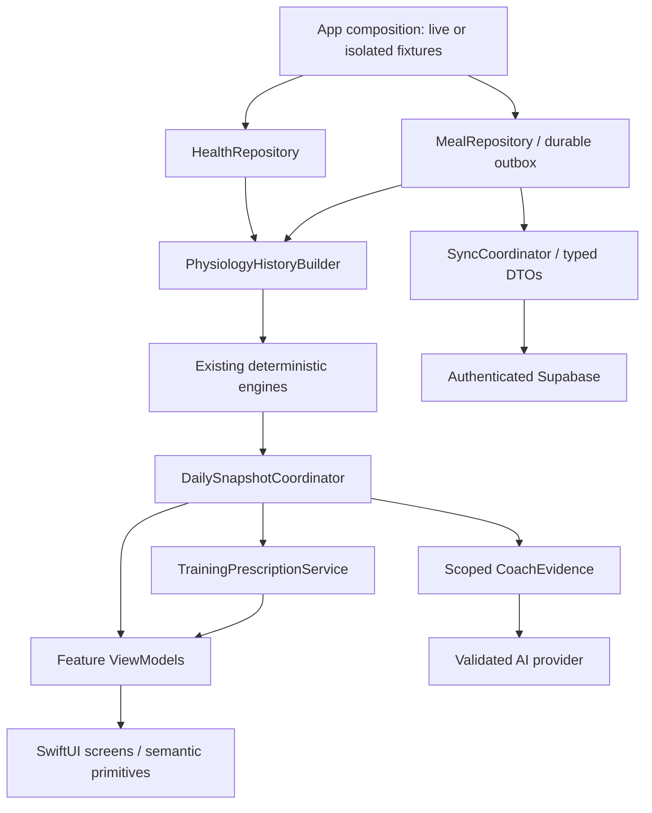

# Lifecore calm native redesign specification

Date: 2026-11-12. Status: proposed, ready for implementation planning. User selected calm native iOS, clear hierarchy and minimal noise. Screens and contracts below are the proposed implementation baseline; no redesign is implemented by this documentation change.

## 1. Product decision and alternatives

Primary job: **understand today's condition, choose the next training action, and record food without losing trust in the evidence**. Secondary job: investigate longer-term changes.

1. **Recommended: reliability-first native redesign.** Preserve native engines/storage, introduce shared evidence/state contracts, replace presentation by vertical slices. More foundational work than a reskin; fewer repeated fixes and a measurable release gate.
2. **Theme-only refresh.** Fast, but retains fabricated values, contradictory prescriptions and restore failures. Rejected because the audit finds state defects behind the appearance.
3. **Full rewrite/new backend.** Maximum freedom, but risks data migration, HealthKit behavior and regression coverage. Rejected: core deterministic modules are reusable; no evidence justifies replacing the platform.

## 2. Global constraints

- Native SwiftUI, Swift Charts, HealthKit, SwiftData; preserve four tabs and current application identity.
- Keep deployment floor iOS 27.0 during this redesign; use Xcode 27.1 for the recorded baseline. Lowering the OS floor is a separate compatibility project.
- Current language mode is Swift 5.0. Migrate to Swift 6 only after actor-isolation fixes and passing tests in R1; never silently change the documented mode.
- English code, comments, prompts and documentation; Ukrainian user-facing strings, food names and coach responses.
- All arithmetic, dates, thresholds and correlations remain native Swift. AI explains supplied evidence; it must not invent missing observations or calculate the calorie buffer.
- Meals and workout attribution use a local 04:00 boundary (`shiftHours = 4`); use Calendar boundaries rather than fixed 86,400-second days. Sleep is an explicit episode, not a blind dietary-day bucket.
- `kcal_final = round(kcal_exact * 1.125)` exactly once in Swift; protein/fat/carbs retain original precision. Legacy buffered kcal is never buffered again.
- Preserve quality-tag taxonomy: `whole_food`, `solid`, `liquid`, `fast_absorbing`, `ultra_processed`, `high_sodium`; apply relevant tags, not all mutually incompatible tags to every food.
- Preserve project illness confluence rules: at least three measured deviations, or temperature delta >= +0.40C plus autonomic shift. Missing pillars cannot be counted as normal measured values; no diagnostic claims.
- All demo/test providers are explicit, isolated and incapable of production network/HealthKit writes.
- Add no third-party application runtime dependency without an identified need. Repository/provider protocols are narrow; no generic framework rewrite.

## 3. Trust and state contract

Every screen distinguishes: loading, genuine empty, partial, fresh, stale, refreshing with retained content, recoverable failure, and unavailable source. HealthKit read denial can be indistinguishable from empty read results: do not claim the app can detect denied read permission conclusively. Offer access guidance and show available coverage.

A metric carries value/unit, observation time, source, method where relevant, coverage and quality. Sources are HealthKit, user-entered, derived, AI-estimated or explicit fixture. A prior is model configuration, never an observation. Missing is not zero. Confirmed no-workout days may contribute zero load; an unknown day may not. No food logs means unknown total intake, not confirmed fasting.

A daily snapshot has one dietary-day identity, revision and generation time. Today, Workouts, Trends and Coach consume the same underlying observations/results. Profile changes, confirmed meals and workout refresh invalidate dependent results through the coordinator. Results from superseded requests cannot overwrite newer state.

AI confidence is an estimate and cannot certify correctness. Nutrition follows draft → analyzing → reviewable estimate → confirmed, with failed/cancelled states. Only confirmed records are exported or counted as confirmed intake. Existing confirmed meals remain intact during migration. Sync status distinguishes saved locally, pending upload, partial failure and synchronized.

## 4. Target component boundaries



Health readers own sample selection and provenance. History builder owns joins/calendar windows. Engines own pure calculations. Coordinator owns caching/invalidation/revision. Repositories own durable mutations. AI adapter owns request/response validation. View models own presentation states; views format and route actions. No health query, cloud request or physiological history join lives in a SwiftUI body/component.

For personal AI access, default to user-supplied provider credentials in Keychain, with an explicit data-sharing setup screen. A server proxy is a later alternative, not required architecture for this redesign. Cloud access uses authenticated identity; mapping existing numeric legacy ownership requires an audited migration, never inference from a client constant.

## 5. Navigation and information hierarchy

Keep tabs: Today, Workouts, Nutrition, Trends. Keep existing Ukrainian tab names. Each root has a NavigationStack and semantic title. Profile, data access, account/sync and AI settings are accessible from a consistent toolbar settings route; remove technical sync/engine panels from the daily content stream.

### Today

Order: date/freshness → one readiness summary → one next-session recommendation/action → compact sleep/vitals/activity rows → latest completed workout. No competing rings with equal visual weight. An explain action opens evidence and coverage. If readiness is unavailable, the first block explains missing coverage and offers source setup; it never starts at 85% or “optimal”. Training advice is unavailable until its required inputs are valid, with a neutral manual planning entry point.

```text
Today                                      Settings
Thursday, 12 November       Updated 08:10
Readiness summary + one sentence
Evidence / coverage
Next session + primary action
Sleep         Vitals         Activity
Latest completed workout →
```

At standard text size, date, primary status and next action should be visible on a compact iPhone without scrolling. Accessibility text sizes may scroll; never shrink text to enforce this target.

### Workouts

Default content is Today's plan followed by History, not a stack of several repeated coaching banners. The plan is the same snapshot as Today. Use a date selector with a selected-day list supporting zero/one/multiple sessions. Historical sessions are observations; future sessions are labeled projections. Filters are visible and resettable; hide-walks only scopes All.

Workout detail order: sport/date → duration/distance/HR/effort summary → relevant chart → splits/laps if available → coach analysis. Strength does not display empty running pace/drift sections. Cycling uses compatible metrics. Route/elevation absence remains absent. Chart inspection has an equivalent readable list/summary for accessibility.

### Nutrition

Date selection is explicit and follows 04:00. Show intake/target with units and logging completeness, meal list, one primary add action. Quality/micronutrients are secondary disclosures.

Capture text/photo → analyze → editable review with estimated label → confirm → saved locally → queued/synchronized. Error retains input and supports retry/manual entry. Manual entry validates values and also applies the native kcal transform once. Review shows exact estimate and buffered tracked kcal so the difference is explainable. Delete has a native accessible action and undo, backed by durable operations, not UI-only removal.

### Trends

Choose a category/metric and 30/60/90-day display range. Show one primary chart, summary/delta with units, measured coverage and accessible inspected observations. Each series has its actual window; fixed-window algorithms are labeled separately from display range. Missing dates remain gaps. Correlations are associations with sign, sample count, interval and uncertainty; no unsupported minute/bpm effect sizes. Algorithm diagnostics and model sensitivities move behind an explanatory disclosure.

### Coach and settings

Use ordinary Ukrainian product language for Coach/Explain, not RAG tiers or engine names. Report maintains70/15/15 emphasis, visible evidence and one next24h action. Structured report, chat, unavailable and retry states share one vocabulary. Serial chat requests preserve order and draft input. Health history sent externally is disclosed before first use. Memory is inspectable/removable; AI-inferred memories require user confirmation and cannot silently become measured facts.

Settings sections: athlete profile; Health access/data coverage; AI setup/data sharing; cloud account/status/retry; stored coach memory. Failure recovery must preserve local records.

## 6. Visual system

Use semantic system backgrounds/labels/separators, system grouped lists where suitable, one restrained green accent for actions. Semantic warning/error styling requires text/icon meaning, not color alone. Support system light/dark appearance; remove global forced-light mode after all surfaces are migrated. No decorative glow, gradient border or nested card hierarchy.

Typography uses system largeTitle/title/headline/body/caption styles with Dynamic Type. Numeric values use monospaced digits, not fixed layout widths. Spacing tokens:4/8/12/16/24/32pt; default page inset16pt; one grouped surface per conceptual section; content-driven height. Controls target at least44x44pt hit regions. Use ViewThatFits/adaptive stacks for large text. Avoid tiny technical badges and all-caps labels. Motion respects Reduce Motion; haptics are optional feedback, never the only confirmation.

Reuse at most five shared primitives initially: MetricRow, SectionHeader, ScreenStateView, PrimaryAction and ChartSummary. Add a primitive only after two real consumers require it. Keep existing accessibility IDs on equivalent controls; when a workflow changes, update its E2E flow in the same integration commit. IDs must be unique among simultaneous controls.

## 7. Persistence and rollout

First preserve user data with explicit migration tests and export/recovery. Introduce schema additions (stable client identity, revision, outbox/tombstone, optional raw kcal/provenance) using versioned migration. Preserve existing remote IDs and buffered kcal. Unknown legacy provenance is `legacy`, not retroactively “verified”. Keep legacy cloud data until restore/ownership checks pass; never reset the database.

Rollout by feature slices after shared contracts stabilize. Compile at every merge boundary. A temporary internal route switch may compare old/new presentation, but both routes must use the corrected data layer; do not retain fabricated production values behind a flag. Remove migration switches after acceptance. Documents describe actual landed behavior at each step, separately from this target spec.

## 8. Acceptance and evidence

- Correctness: every P1 audit finding has a failing-before/passing-after regression; persistence/cloud round trips retain fields and identity; one shared prescription across tabs.
- State matrix: empty/partial/fresh/stale/offline/error/refresh for each root, AI unavailable and failing save/sync. No zero-filled fake health or hidden demo export.
- Layout: compact/standard/large iPhone, long Ukrainian content, standard and largest accessibility text, light/dark. Readiness and add-meal paths remain operable without clipping critical actions.
- Accessibility: VoiceOver labels/order/actions, chart alternatives, Reduce Motion, Increased Contrast. Screenshot checks cannot replace VoiceOver testing.
- Dates:03:59→04:00, midnight workouts, Europe/Budapest spring/fall DST, timezone changes. Meal attribution is recorded at creation and not silently rewritten after travel.
- Performance: measure cold/warm launch and tab refresh on an identified device/fixture; report median/p95 and main-thread stalls. Do not inherit older <5ms/<5s claims without measurements.
- Release: deterministic unit/integration tests and outcome-based E2E pass; release build passes; credentials absent from bundles; RLS cross-user denial verified in isolated staging before wider use.

## 9. Scope boundary

This redesign does not add a social feed, Apple Watch client, generic chatbot product, new clinical model, backend rewrite or lower-OS support. Route/elevation ingestion correctness may be improved in R3b; missing route support must never block truthful display. Clinical validity and medical thresholds require separate domain review; this plan preserves project behavior while correcting data integrity.

Sources: [audit and verification](../../audits/2026-11-12-architecture-and-product-audit.md); [Apple accessibility](https://developer.apple.com/design/human-interface-guidelines/accessibility); [Apple Dark Mode](https://developer.apple.com/design/human-interface-guidelines/dark-mode); [Supabase RLS](https://supabase.com/docs/guides/database/postgres/row-level-security).
